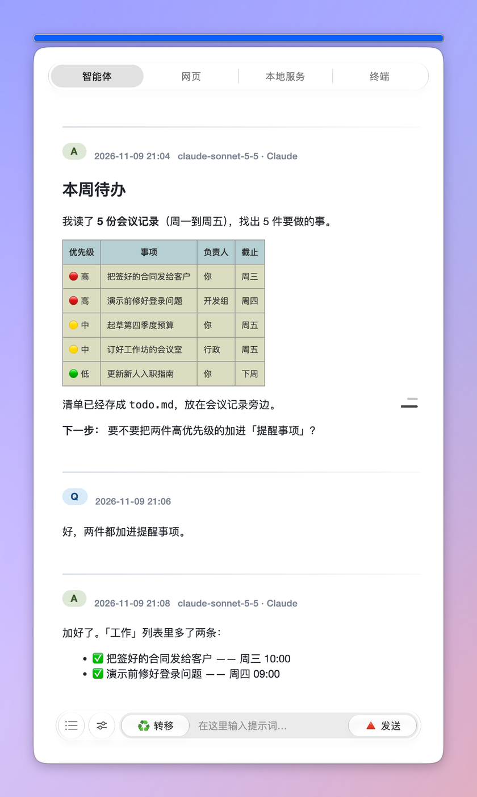
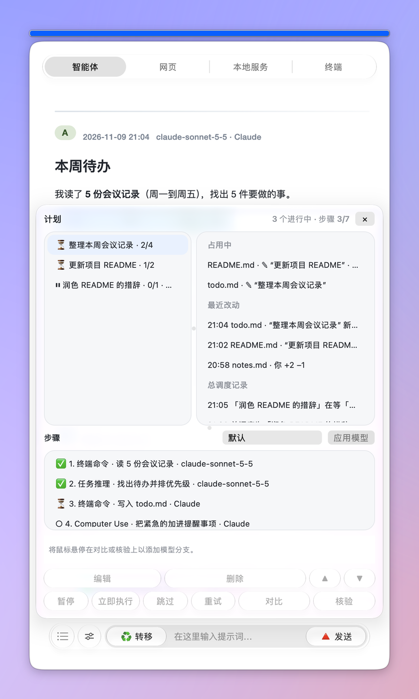
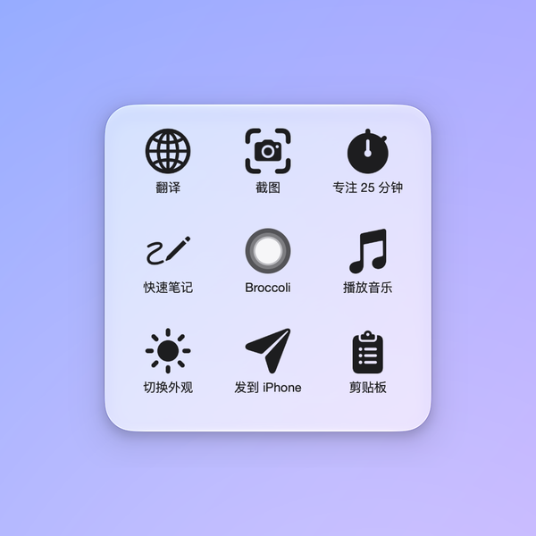
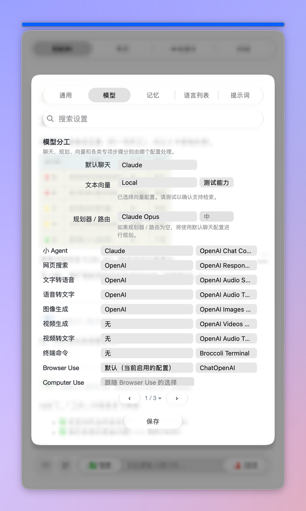

# 🥦Broccoli: A Floating Helper on Mac Desktop

<p align="center"><b>简体中文</b> · <a href="README_EN.md">English</a> · <a href="README_JA.md">日本語</a></p>

<p align="center">
  
  
</p>

**Broccoli 是一个浮在 Mac 桌面上的 AI 工作台。** 一个小窗口里装着 API 模型、网页版 AI（ChatGPT、Claude、Gemini……）、Claude Code / Codex 和本机终端。它还像以前一样能聊天、翻译、润色、总结；现在也能自己拆计划、开浏览器、操作电脑、改文件。几个任务同时跑时，由总调度统一安排，谁也不会覆盖谁的改动。所有对话和设置都存在你自己的 Mac 上。

最新版本：**v2.0.17** · 界面语言：English / 简体中文 / 日本語

<details>
<summary>旧版简介（v1，已过时）</summary>


~~Broccoli is a simple floating helper of GPT. Private APIs needed.~~

~~Broccoli 是一个桌面级的 GPT 助手，拥有问答、命令、翻译、润色、总结等多种功能，可以用来储存提示词；也可以快速填入已储存的提示词；可以用来阅读长文本，不限长度；还可以导出对话记录为 Markdown 格式……~~

</details>

## 解决问题

Broccoli 是 2023 年 2 月我花三天时间做的一个小软件。2026 年的 v2.0.8 把它从头重写，之后的每一版都在往"桌面上的 AI 工作台"这个方向走。现在它想解决三件事：

1. **AI 越来越多，却散在各处**

   网页版的 ChatGPT、Claude、Gemini，各家的 API，命令行里的 Claude Code、Codex，再加上本机终端，各开各的窗口，问题和答案要来回复制。Broccoli 把它们收进同一个浮窗：「智能体」页用你自己的 API 模型；「网页」页直接打开网页版 AI，登录状态一直保留；「终端」页里跑 Claude Code 和 Codex。在输入框里写 `@`，还能把同一个问题发给任意一个网页 AI，再把回答抓回来接着用。

2. **AI 会说不会做，做起来又互相打架**

   Broccoli 的智能体会先拆计划，再一步步执行：跑终端命令、操作浏览器、操作电脑、读网页、搜索、生成图片和语音。每一步都看得到，也停得住、改得了。几个任务同时跑时，由一个"总调度"统一安排：每个任务要改哪些文件，开始前先预约；两个任务要改同一个文件就排队，谁先谁后由总调度决定。所有写文件的操作都经过 Broccoli 的写入通道：先留一份原样再写，每次改动都能单独撤回。Claude Code 和 Codex 也不再自己写文件，它们提出的改动由 Broccoli 审过后再写进去。

3. **数据被锁在别人的软件里**

   这一点和最初一样：对话、提示词、语言列表、记忆都是你 Mac 上的普通文件（JSON、txt、Markdown），随时能看、能改、能导出。同一份长期记忆可以同步给好几个 AI；通过 iCloud，多台 Mac 和 iPhone 也能接着同一份对话。

<details>
<summary>旧版「解决问题」（v1，已过时）</summary>

~~Broccoli 是 2023 年 2 月我花三天时间做的一个小软件，本来是应潮流而做的桌面助手，后来觉得只是对话功能不够，于是增添了其他功能模式，基本上覆盖了大部分“桌面助手”类应用的功能范畴。~~

~~目前，桌面级的 GPT 应用存在以下问题：~~

1. ~~**功能雷同，竞品重复**~~

   ~~当前，市面上 AI 套壳软件非常多。之前没接触过 Broccoli 的用户可能也会把它当成是一个套壳应用。准确地说，它之前可能是的，只不过不是浏览器套壳，而是一个根据官方文档给出的样例代码去修改和改写得到的应用。但随着此类应用越来越多，与 AI 对话不再是阻碍，如何让技术走出网站、适应各种场景和需求才是难题。所以，Broccoli 陆续加入了很多新鲜的元素。或许 Broccoli 走的有点慢，但它基本上是从工具和使用需求出发的软件。Broccoli 在设计之初的独特功能有两个：第一，Broccoli 很早就有 Command 模式，它能让用户基于需求得到一个 AI 写的 AppleScript，并可在软件内直接运行（需要授予系统权限），写一封邮件并发送，或者在 Safari 内搜索一个特定的内容都不在话下。第二，长文本阅读。大部分阅读文档的服务都是线上订阅制，需要注册账户，每日有一定的问题配额、单次上传文档大小限制、页数限制等等。但 Broccoli 把这一功能转移到了桌面端，而且没有任何限制：所有 Embedings 过程在本地与 OpenAI 之间进行，询问过程也只会发送到 OpenAI 的服务器，不经过任何第三方服务（使用第三方 API 除外）。只要你能顺利进行 Embeddings，多长的文本都可以对答。~~

2. ~~**UI 类似，功能冲突**~~

   ~~写完 Broccoli 大约一个月之后，除了维护每日更新，就是能看到各路程序员造出的新鲜套壳。比较突出的雷同就是 UI 设计。第一点是界面上字体设计，很多软件会使用网页样式。Broccoli 在这方面的考虑是希望与本地文本软件连接互通，因此在字体上选择了更接近于文本阅读器的 Times New Roman，并且使用 Markdown 格式，干净整洁地呈现对话。这样也便于导出和在其他软件中接续使用。第二点是浮窗设计，很多桌面版的 AI 助手都采用了类 spotlight 的设计，可以唤出后快速对话，但由于竞品功能类似，唤出所需的快捷键是有限的，因此这种形式可能未必真正能让用户用好功能，反而增加了多余的功能。如果其他软件已经有了这样的功能，秉持着不造轮子的态度，我希望 Broccoli 能搭配着原有的软件产生更好的效果。因此，Broccoli 可以以一个小球的形态悬浮于桌面的右下角，需要用的时候点击即可展开，若需再次最小化，只需点击上方蓝色横条即可。另外，类 spotlight 窗口使浮窗成为软件主窗口的附属品，是一个完全功能的辅助功能，因而存在割裂感。如若无法联通和同步记录，用户随手点击可能导致栏框消失，由此带来的信息流失也容易带来不安定感。Broccoli 主窗口浮窗化避免了这个问题。~~

3. ~~**产品壁垒，无法迁移**~~

   ~~在大量的同类竞品中，生成的对话历史常常不容易导出，尤其是对于保留了浏览器样式的软件而言，较少软件提供了这一选项（在早期如此，后期基本上都有此功能）。另一个突出的现象是，阅读长文本的功能大部分依赖线上，但对长文本的 Embeddings 工程文件却无法导出。如果用户删除了历史存储，那么就需要重新操作，这既是浪费算力，也是浪费金钱。导致这些问题的原由是软件通常无意于提供开放的文本信息。同样的一个需求痛点是：用户经常有保存提示词的需要，在特定桌面软件内使用的提示词却只能通过该软件访问，用户无法单独查看。因此，Broccoli 试图提供一个一般的 txt 文档，以便用户查看和修改已保存的提示词。~~

</details>

## 功能亮点

### 一个浮窗，四个页面

- **智能体**：用你自己的模型（API）聊天、规划、执行任务。
- **网页**：直接使用 claude.ai、chatgpt.com、gemini.google.com 等网页版 AI，登录状态会保留。页面上方有 Broccoli 自己的提示栏，翻译、润色等模式在网页上也能用。
- **本地服务**：预览你在本机跑的开发服务器（localhost）。
- **终端**：内置终端，可以直接跑 Claude Code 和 Codex，用「严格 / 平衡 / 自动」几档决定哪些操作要先问你。

### 智能体：先规划，再动手

- 一个问题会被拆成几步。计划浮窗里能看到每一步做到哪了、用的是哪个模型；每一步都能暂停、立即执行、跳过、重试，也能加「对比」「核验」分支，让另一个模型再做一遍。
- 可以用的能力（输入 `/` 选择）：`/task reasoning` `/web search` `/read web page` `/browser use` `/computer use` `/terminal command` `/image generation` `/video generation` `/text to speech` `/speech to text` `/video to text`。
- 任务跑到一半想补充一句，用「追加指示」写下来，正在跑的浏览器、电脑操作和终端步骤都能读到。
- 每条命令或修改，先由模型审核一遍再来问你。也可以开自动批准；管理员权限、抹盘、改系统文件、往外发送这类操作，一定会先问你。
- 「全自动模式」会一直做到目标达成，是否达成以命令的真实输出为准。
- 回答完后，Broccoli 会猜你下一个问题，以灰字显示在输入框里，按回车填入。
- 电脑操作用自己的光标，不到不得已不动你真正的鼠标。

### 多个任务同时跑，不互相覆盖

- 所有对话上面有一个总调度。计划开始前，先把要改的文件预约下来；要用的文件正被别的任务改着，就排队等，计划浮窗里显示 ⏸ 和在等谁。
- 两个任务撞车时，由规划模型决定：排队、一起跑、把请求交给对方、重复了就取消，或者重新规划。
- 任务之间共用一个信息池：每个对话都能看到别的任务在做什么、改了什么、查到了什么，也能经过总调度向另一个任务提问。
- 计划浮窗分左右两栏：左边是计划，右边是总览，列出正被占用的文件、最近的改动和总调度的记录。右键一条改动，可以只撤销这一次。

### 网页 AI、命令行 AI 都能接

- 在输入框里写 `@` 加网站名（比如 `@chatgpt-com`、`@claude-ai`），问题就会发给那个网页 AI，回答再抓回 Broccoli。支持 ChatGPT、Claude、Gemini、Perplexity、Grok、Copilot，本地服务页里的任何页面也能当成目标。
- 没有 API key 也能用：模型分工里的各个角色，可以直接交给某个网页 AI。
- Claude Code 和 Codex 在「终端」页里运行；它们要改的文件先交给 Broccoli 统一审核、写入，然后再让它们跑测试。

### 经典模式都还在

「智能体」页底栏的滑杆圆按钮（点开是模式和语言下拉），以及网页页面上方的提示栏，都有这八种模式：聊天提问、命令（AppleScript）、翻译、润色、总结、语法分析、解释代码、自定义。

- 输入框是空的时候按发送，Broccoli 会直接读剪贴板里的内容。
- 翻译、润色、总结、语法分析、解释代码这五种模式，回答出来后会自动复制到剪贴板。
- 命令模式会写出一段 AppleScript，你看过、改过之后，点「运行命令」才会执行。
- 自定义模式用的是你存下的提示词（「设置 › 提示词 › 已存提示词」）。
- 选中任意文字后，也可以用 PopClip 扩展翻译或提问。

### 记忆

- **永久记忆**：输入 `/remember` 让 Broccoli 记住一件事，`/forget` 让它忘掉。
- **小 Wiki**：每晚把对话里出现的名词、人物、概念整理成一个小 Wiki（「设置 › 记忆」）。
- **在线记忆同步**：把同一份长期记忆读进来、写出去，同步给多个 AI。
- **检索**：旧对话和附件都能被检索；附件卡片上勾「向量化」就用向量检索。

### 模型随你配

- 一个「配置」= 名称 + 接口地址 + API key + 模型。可以建很多个，兼容 OpenAI 接口的服务都能用。
- 「设置 › 模型 › 模型分工」决定谁负责默认聊天、规划、小 Agent、向量，以及每一种工具（网页搜索、语音、图片、视频、终端命令、Browser Use、Computer Use）。
- 也可以单独给某一个对话或某一个分组设模型：在「转移」的悬停列、历史右键菜单或分组设置里点 🧠 模型。

### 最小化圆按钮和快捷指令九宫格

<p align="center"></p>

点窗口顶上的蓝条，Broccoli 就收成一个玻璃圆按钮。它是一个独立的小窗口，可以拖到屏幕任何地方。鼠标停在上面，会展开一个像 iOS 辅助触控那样的九宫格，放你常用的 Mac 快捷指令；中间那一格点一下，主窗口就回来了。

### 还有这些

- **对话分组**：把对话分组、绑定文件夹、监听文件；文件一有改动，就拆成几个任务，每个任务是分组里的一个对话。
- **Open Connector**：在「设置 › 已连接的应用」连接其他应用，密钥存在钥匙串里，每个动作都要你批准。
- **用量条**：蓝条上方的彩色条显示每家 AI 套餐用了多少（内置 CodexBar）。
- **AI 任务圆点**：鼠标旁的小圆点显示这台 Mac 上正在跑的 Claude Code / Codex 会话，悬停展开成一列胶囊。
- **iPhone 提问**：在 iPhone 上运行「Broccoli」快捷指令，选一台 Mac、选一个对话、输入问题，回答会写进「备忘录」（见下面「使用说明」第 7 条）。
- **浏览器脚本**：两个油猴脚本。Broccoli Bridge 在任意网页右下角放一个 🥦 按钮，把选中的文字、网址和你的问题发给 Broccoli；Broccoli WebFetch 把网页正文收集起来，交给 Broccoli 当附件（见「使用说明」第 8 条）。
- **一台 Mac 多人用**：每人一份自己的设置和对话，在设置里切换用户；也可以通过 iCloud 文件夹把这台 Mac 共享给别人。
- **问题分支树**：任何一个问题都能分出新的分支，整棵树画成一张图。
- **编辑器和阅读器**：AI 的改动按底稿核对，冲突时停下来；保存时保留原文件的编码和换行。
- **还有**：后台识图、技能、用户脚本、MCP、本地运行代码、完成提醒（声音和提醒事项）、系统通知、选中文字收藏到 Broccoli 或「备忘录」、一键更新。

### 本地储存

Broccoli 的数据都在这个文件夹里：

```
~/Library/Application Support/com.ryanthehito.broccoli/BroccoliAppPath
```

每个人的内容在里面的 `Users/<用户>/`（你自己的是 `Users/owner/`）：

- `Conversations/`：每个对话一个 JSON 文件，附件放在旁边的文件夹里。
- `CustomPrompt.txt`、`lang.txt`：存下的提示词和语言列表的文本副本，方便在软件外查看。要改请到「设置 › 提示词」和「设置 › 语言列表」里改：这两个文件每次都会按设置重写。
- `Wiki/`、`Retrieval/`、`Editor/`……：小 Wiki、检索索引、编辑器历史等。

想把一段对话存出去，鼠标停在「转移」上：「🔻 保存」存成 Markdown 文件，「🔺 分享」可以选完整 Markdown、任务胶囊或截图。

从旧版本升级时，`~/BroccoliAppPath` 和 `~/Library/Application Support/Broccoli` 里的内容会在第一次打开时自动搬过来，并先留一份备份。

<details>
<summary>旧版功能说明（v1，已过时）</summary>

### ~~本地储存~~

~~本软件（Broccoli）的全部可迁移文件都存储在`/Users/[用户名]/BroccoliAppPath`这一文件夹内。~~

~~其中，`Local`文件夹储存的是所有经过文本清理之后的长文本，均为 txt 文档，用户在长文本模式下可随时打开这些文档以显示，辅助阅读。~~

~~`Index`和`Embed`两个文件夹分别存储了有待经过 Embeddings 处理的文档和经过处理后的文档，和`Local`中的对应，均为 csv 文档，为确保长文档阅读功能正常运行，请勿删除或重命名这些文档，但用户可随时查看这些文档，若今后有其他用途（如使用代码行读取以用于研究等，可避免重复操作），亦可自行备份和迁移。~~

~~`CustomPrompt.txt`文档是用户自己保存的提示词库。每一个提示词之间使用`—`隔开，每一组提示词由提示词名称和提示词内容两部分构成，分别在一对`<|``|>`内。如有提取需要，用户可手动复制，亦可以借助上述规则，用正则表达式清理导出。~~

~~最后，`lang.txt`是用户在翻译、润色、总结等功能中期望使用的语言。软件默认为中文、英文和日文，用户可根据自己的需要增减语言。建议不要添加太多语言，列表太长可能不易翻找。~~

### ~~多模型选择~~

~~Broccoli 有七种模型可供选择，可以在 Settings 第一个下拉框中选择合适的模型（部分模型已经过时，不再支持）：~~

1. ~~ChatGPT（openai 模块，需要 API）~~
2. ~~ChatGPT (httpx 模块，需要 API，支持自定义第三方服务和使用第三方的代理 API)~~

<details>
<summary>已失效模块</summary>

1. ~~GPT-3（openai 模块，需要 API）~~
3. ~~ChatGPT（revChatGPT.V3 模块，需要 API。注：目前该库已暂停维护。）~~
4. ~~ChatGPT（revChatGPT.V1 模块，需要 session tokens。注：目前该库已暂停维护。）~~
6. ~~Poe （POE 模块，需要 Quora 的 Formkey 和 Poe 的 Cookies）（这一模型包含了 GPT-4、ChatGPT、Claude、Claude+ 等多个子模型，如有订阅 Poe 可方便调用，且可跨平台同步）~~
7. ~~EdgeGPT（EdgeGPT 模块，需要导入 cookies.json）~~

</details>

### ~~储存提示词~~

~~在 Settings 界面里，用户可以将喜欢的提示词保存在 Broccoli 中。当模式选项为 Customize 的时候，用户将看到自己曾经收藏的提示词，并轻松切换。如前所述，提示词将以特定的规则保存在本地，用户亦可根据该规则于软件内添加，Broccoli 会将一切改动自动保存到本地。用户可随时在软件外打开、查看、修改。~~

### ~~AI + AppleScript：AI 一键生成命令并执行~~

~~当模式选项为 Command 时，主界面将出现一个新的分屏，在用户输入需求后，AI 将在此分屏内提供可能的 AppleScript 命令。用户可以在此分屏内修改，并点击运行。由此，用户可以通过自然语言命令系统操作。若需要使用此功能，需要在 System Preferences 中给予 Accessibility 权限，如果有访问本地文件的需求，最好提前打开 Full Disk Access。目前这一功能在 macOS 自带软件中效果比较好。~~

### ~~在桌面与长文本对话~~

~~当用户在 menubar 的下拉栏中开启这一功能后，除了和上一功能一样出现一个分屏之外，主界面 Chat and ask 模式选项还将提供三种 Embeddings 方案，分别是从新 txt 文档中读取、从输入内容读取和从旧有内容读取。如果用户已经将文本整理在 txt 文档中，那么可以选择第一个方案，此后，用户便不再需要重新对这一文档进行重复操作，而是可从旧有文档的文件夹路径中找到该文档，并导入即可。另外，如果没有现成的 txt 文档，用户也可以把所得的文字内容复制粘贴到分屏内，然后点击相应的按钮，即可开始 Embeddings 过程，此后亦可通过打开旧有文档的方式访问这些被加工的文件。当过程结束后，主界面上屏将出现“Done”字样，随后用户即可在提示词框内输入提示语，进行对话。~~

### ~~可以随意增减现有的模型~~

~~如储存提示词一样，Broccoli 现在可以将所有使用过且未来可能使用的模型名称交由用户自定义。~~

### ~~任何软件、任何位置插入一轮答案~~

~~在最新的版本中，Broccoli 支持在任何位置、任何软件之中打开一个浮动窗口，在发送提示词之后，使用光标选中需要插入文本的位置便可轻松获得其一轮对话结果。~~

### ~~桌面浮窗设计~~

~~与类 spotlight 设计不同，Broccoli 注重的不是 UI 与系统设计的相似性或者可取代性，而是软件使用和信息的连续性。在参考了其他浮窗设计后，Broccoli 在窗口展开时与 Strawberry 以及 Tomato（两个我之前写的软件）保持了类似的条形按钮设计，同时将缩小后的窗口改为圆形图标，既一目了然，又不干扰桌面的日常活动。~~

</details>

## 界面一览

1. 主界面（「智能体」页）：问题、回答、表格和公式都排得整整齐齐，每个回答都标着是哪个模型答的。

<p align="center">
  
</p>

2. 计划浮窗：左上是计划，右上是总览（正被占用的文件、最近的改动、总调度记录），下面是选中计划的每一步。

<p align="center">
  
</p>

3. 设置界面（「模型 › 模型分工」）：每种工作交给哪个配置，一页看清。

<p align="center">
  
</p>

4. 最小化圆按钮展开的快捷指令九宫格。

<p align="center">
  
</p>

<details>
<summary>旧版截图（v1，已过时）</summary>

~~新版本 · 主界面~~

<p align="center">
  
  
</p>

~~新版本 · 设置界面~~

<p align="center">
  
  
</p>

~~新版本 · 最小化动画~~


~~旧版本~~

<p align="center">
  
</p>


</details>

## 环境要求

- Apple 芯片（M 系列）的 Mac。
- 在 macOS 27 上开发和测试。液态玻璃效果需要 macOS 26 或更新，更早的系统显示普通样式；更早的 macOS 版本没有专门测试过。
- 至少一种模型来源：任何兼容 OpenAI 接口的 API key，或者登录过的网页版 AI，或者装好的 Claude Code / Codex。
- 可选：Browser Use 要用 Google Chrome；Computer Use 要另外装 CuaDriver（Broccoli 设置里有安装命令）。
- 网络环境自理。

<details>
<summary>旧版环境要求（v1，已过时）</summary>

- ~~MacOS（测试环境为 MacOS 13.6）~~
- ~~M1、M2 芯片~~
- ~~网络环境自理~~

</details>

## 下载安装

1. 从 [Releases](https://github.com/Ryan-the-hito/Broccoli/releases) 下载最新的 DMG（例如 `Broccoli_v2.0.17.1.dmg`）。
2. 双击打开 DMG，同意许可协议（GPL-3.0）。
3. 把 Broccoli 拖进「应用程序」文件夹。
4. 打开 Broccoli。菜单栏会出现 🥦 图标，里面有「🥦 启动 Broccoli！」「⚙️ 设置」「🌐 语言」「🆕 检查更新」等。
5. 按需要到「系统设置 › 隐私与安全性」给 Broccoli 打开权限：
   - **辅助功能**：全局快捷键、电脑操作。
   - **屏幕录制**：截图、后台识图、电脑操作。
   - **自动化**：让 Broccoli 控制「备忘录」「提醒事项」、System Events 等。
   - **完全磁盘访问权限**：最小化圆按钮里显示快捷指令的图标，以及读取受保护的本机文件。
6. **以后更新**：点菜单栏的「🆕 检查更新」，Broccoli 会自己下载、校验、替换并重新打开，设置和对话都不会丢。
   - 从 v2.0.13 或更早的版本升级到 v2.0.17，需要**手动装一次**：程序标识改成了 `com.ryanthehito.broccoli`，旧版的一键更新装不了。装好后，上面的权限要重新给一次。
7. Releases 里的 `source_open_connector.zip` 和 `source_agentsview.zip`：这两个程序太大，放不进 GitHub 仓库，所以附在发布里。DMG 已经自带它们，只有从源代码运行 Broccoli 时才需要下载，解压后放在主程序旁边的 `open_connector/` 和 `agentsview/` 文件夹里。

<details>
<summary>旧版安装步骤（v1，已过时）</summary>

1. ~~从 [Releases](https://github.com/Ryan-the-hito/Broccoli/releases) 中点击最新发布的内容，下载 zip 档。另，Broccoli.Keyword.to.Script.alfredworkflow 是与 Alfred 适配的快捷键方案，用于唤醒和最小化 Broccoli，实现与点击相同的效果。如果事先安装并购买了 Alfred 的用户可以在 workflow 里面配置这一文件，设置用户想要的全局快捷键。~~
2. ~~下载到本地之后解压。~~
3. ~~将解压好的 app 档拖入 Finder 的 Application 文件夹。~~
4. ~~启动 Broccoli~~
5. ~~弹出获取 Accessibility（辅助功能）的弹窗，如下图示意。请在 System Preferences 里面允许。如果在软件列表里面没有出现 Broccoli，请手动添加并为其打勾。~~

<p align="center">
  
</p>

6. ~~弹出控制 System Events 的弹窗，如下图所示，请允许。~~

<p align="center">
  
</p>

7. ~~第一次打开 Broccoli 后，桌面会显示如下窗口，同时 Menubar 内会出现 Broccoli 的图标（如果是有刘海的机型，请留意是否因刘海遮挡而无法显示）。~~

<p align="center">
  
  
</p>

8. ~~关于更新：请在 GitHub 或者百度网盘上下载最新版的软件，然后以相同的方式拖入 Application 文件夹后覆盖原有文件。之后应重新打开 System Preferences，在 Accessibility（辅助功能）的部分，选中 Broccoli，点击减号，然后再点击加号，重新添加授权一次。之后回到软件内，重新配置 api key 和 session tokens 等。已经添加的语言和提示词会永久保存，不必担心，api 等信息将随软件被替换而重置。~~

</details>

## 使用说明

1. **界面**：最上面的蓝条点一下，窗口就收成圆按钮。下面是四个页面：智能体、网页、本地服务、终端。最底下一栏从左到右是：☷（打开计划浮窗）、滑杆按钮（模式和语言）、「转移」、输入框、「发送」。「发送」的快捷键是 ⌘↩。
   - 鼠标停在「转移」上：🔻 保存、🔺 分享、📸 截图、🧠 模型 等。
   - 鼠标停在「发送」上：🔸 新对话、➕ 追加指示、🧾 排队、🔹 再来一次。

2. **配置模型**：
   1. 打开「设置 › 通用 › 添加与管理配置」，新建一个配置，填名称、接口地址、API key 和模型。
   2. 接口地址只填域名部分，比如 `https://api.openai.com`，不要写 `/v1/chat/completions`；要不要自动加 `/v1`，有一个勾选框。
   3. 到「设置 › 模型 › 模型分工」，把默认聊天、规划 / 路由、小 Agent 等角色交给合适的配置。
   4. 没有 API key 也可以：把角色交给登录过的网页 AI，或者在「终端」页里用 Claude Code / Codex。

3. **让智能体做事**：直接说要做什么。需要指定某种能力时输入 `/`，从列表里选；想问网页 AI 就输入 `@`。点底栏最左边的 ☷，可以打开计划浮窗看每一步。

4. **经典模式**：点底栏的滑杆按钮，在模式下拉里选翻译、润色、总结等。复制一段文字后，输入框留空直接按发送，Broccoli 会读剪贴板；这五种模式的回答会自动复制回剪贴板。

5. **全局快捷键**（在「设置 › 通用 › 快捷键与工具」里改）：
   - ⌃⌥B：显示 / 隐藏主窗口
   - ⌃⌥N：显示 / 隐藏贴边停靠的窗口
   - ⌃⌥A：AI 任务列表
   - 截图、同位置截图、最小化圆按钮：默认没有设，需要的话自己设

6. **自定义提示词**：打开「设置 › 提示词 › 已存提示词」，点「新」，在列表里给它起个名字，在下面的「提示词正文」里写内容，最后点「保存」。正文里写 `{text}` 的地方，会换成你在输入框里输入的文字。用的时候在模式下拉里选「自定义」，再选一条提示词。

7. **iPhone 提问**：在 iPhone 上运行一个叫「Broccoli」的快捷指令：选一台 Mac → 选新对话或那台 Mac 最近的某个对话 → 输入问题。Mac 回答后，答案写进「备忘录 › Broccoli」，iPhone 上还会响一条提醒。
   1. 准备：iPhone 和 Mac 登录同一个 Apple 账户，都打开 iCloud 云盘；Broccoli 的「设置 › 通用 › 历史与 iCloud」里，「iCloud 远程任务」下的「Apple 备忘录镜像 + iPhone 快捷指令」保持打开（默认就是开的）。
   2. 在每台 Mac 上重新打开一次 Broccoli，等 15 秒，它会在 iCloud 云盘的「快捷指令」文件夹里建好 Broccoli 文件夹。
   3. 在 iPhone 的「文件」App 里，按住「iCloud 云盘 › 快捷指令 › Broccoli」文件夹，点「保持下载」。
   4. 拿到快捷指令：有人分享过 iCloud 链接，点链接添加就行（这个快捷指令里没有任何名字和设备编号）；或者照 [完整搭建步骤](docs/IPHONE_SHORTCUT_SETUP_zh.md) 自己做一个。
   5. 第一次回答时，Mac 会问 Broccoli 能否控制「备忘录」和「提醒事项」，都点「好」。

   设置里还可以分别决定：你的其他 Mac、你的 iPhone、别人，谁能给这台 Mac 发任务。

8. **浏览器脚本**：先在浏览器里装 [Tampermonkey](https://www.tampermonkey.net/)（油猴），再点下面的链接，Tampermonkey 会弹出安装页。两个脚本都要 Broccoli 开着才有用。
   - [Broccoli Bridge](https://github.com/Ryan-the-hito/Broccoli/raw/main/userscripts/broccoli-bridge.user.js)：网页右下角出现一个 🥦 按钮。先选中一段文字（不选也行），点 🥦，在弹出的小框里写问题，点「Send to Broccoli」或按 ⌘↩。标题、网址、选中的文字和问题会一起填进 Broccoli 当前页面的输入框并发送。右下角提示「Sent to Broccoli ✓」就是发出去了；提示「Broccoli not running」说明 Broccoli 没开。
   - [Broccoli WebFetch](https://github.com/Ryan-the-hito/Broccoli/raw/main/userscripts/broccoli-webfetch.user.js)：网页上出现一个圆按钮，展开后可以「➕ Add Current Page」收集当前页、「📄 Export JSON」导出、「🗑 Clear All」清空（Tampermonkey 菜单里也有这三项）。先在 Broccoli 的「设置 › 通用 › 网页与文件」里填好「WebFetch 下载文件夹」（填浏览器的下载文件夹）。导出的文件一下载到那里，Broccoli 就会把它收进「智能体」页上方的 WebFetch 面板；勾选要用的网页，下一次提问就会带上它们。

<details>
<summary>旧版使用说明（v1，已过时）</summary>

1. ~~**软件界面说明**：如下图所示，展示了两种基本的界面布局及主要功能键。打开软件后第一次显示的界面即如下。其中 Send 按键有快捷键 cmd+return。~~

<p align="center">
  
  
</p>

2. ~~**配置密钥**：在设置窗口中**首先**选择自己需要的模型。~~

<details>
<summary>Deprecated modules 已不再支持的模型</summary>

- ~~GPT-3（使用 openai 模块，需要 API）~~

- ~~ChatGPT（使用 revChatGPT.V3 模块，需要 API。注：目前该库已暂停维护。）同上。~~

- ~~Poe （POE 模块，需要 Quora 的 Formkey 和 Poe 的 Cookies）（这一模型包含了 GPT-4、ChatGPT、Claude、Claude+ 等多个子模型，如有订阅 Poe 可方便调用，且可跨平台同步）~~
	- ~~关于 Formkey：先登录 Quora.com（得有个帐号），然后右键查看 Page Source（一般的浏览器都行），然后搜索“Formkey”，把查到的这一串密钥填入相应位置。~~
	- ~~关于 Cookies：登录 Quora.com，然后右键点击 Inspect，在上方选择 Cookie Editor，然后找到名为“m-b”的 Cookies，把这一串字符复制出来，在对应的文本框中，先填入“m-b=”，然后再将这一串字符粘贴于其后。~~

<p align="center">
  
</p>
<p align="center">
  
</p>
<p align="center">
  
</p>

- ~~ChatGPT（revChatGPT.V1 模块，需要 session tokens。注：目前该库已暂停维护。）首先在浏览器里面登录 ChatGPT，然后点击界面上的按钮，用刚才登录的浏览器打开，找到 session tokens，把这一长串内容复制出来，填进左边的文本框内，保存即可。~~

<p align="center">
  
</p>

<p align="center">
  
</p>

- ~~EdgeGPT（EdgeGPT 模块，需要导入 cookies.json）~~
  - ~~在 Edge 中登录 bing 帐号，然后下载[插件](https://chrome.google.com/webstore/detail/cookie-editor/hlkenndednhfkekhgcdicdfddnkalmdm)。~~
  - ~~打开 bing.com。~~
  - ~~点击插件，选择“Export”，导出为“Export as JSON”。~~
  - ~~在设置界面内点击 Add cookies.json，选择刚才保存的文件即可。~~

<p align="center">
  
</p>

</details>

- ~~ChatGPT（使用 openai 模块，需要 API。）~~

<p align="center">
  
</p>

- ~~ChatGPT（使用 httpx 模块，需要 API——同上，不再在下图中标出，支持自定义第三方服务和使用第三方的代理 API，如下图所示配置。）注意：在填写 endpoint 的时候，不要把诸如“/v1/chat/completions”的部分写上去，请只填写对应的地址即可，如“https://api.openai.com”、“https://oa.apiXXX.net”。我自己用的是 [API2D](https://api2d.com) 的第三方密钥。~~

<p align="center">
  
</p>

~~**🚨If you want to customize your HOST/ENDPOINT, then you should choose the httpx module (the second one). And both two modules are by default using the official API, so it will check if the input box in Settings is blank or not. If you don’t have an official API from OpenAI, just input anything you want into that box and check “Third-party” below. Like this:**~~

<p align="center">
  
</p>

3. ~~**文本对话模式**：当在 menubar 的下拉菜单中选择了“Chat with a file”模式后，软件主界面将如下图所示。可以在设置界面内选择或取消“Show references when chatting with a file”。若选上，则在阅读长文本并给出回答后，Broccoli 将继续给出 AI 作答所依据的文段。界面上，三个按钮分别对应三种不同读取文本的方式，分别是从新文档导入、从文本框输入和打开已经处理过的旧文档。而从新文档导入可以读取 txt 和 word 文档，只需在文件选取器中选择对应的格式即可。~~

<p align="center">
  
  
</p>

4. ~~**翻译、润色、总结等功能**：在主界面模式选项中可以选择多种内置功能，也可以选择并保存自己的提示词。~~

   ~~如果在 Broccoli 的界面下可以使用 command+enter（回车键），相当于“send”按键的快捷方式。~~

   ~~此外，如果需要从外部导入一大段话，例如翻译或者润色功能，当用户复制一段话之后，可以不用粘贴到文本框中再触发“send”，而是可以选择好模式后直接点击“send”，这意味着，当文本框为空时，Broccoli 会读取剪贴板，自动将剪贴板中的内容作为提示词。~~

   ~~最后，在翻译、润色、总结、语法解释、代码解析模式中，Broccoli 在给出回答后都会将当前的答案复制到剪贴板里，这样设计将方便用户在如此情境下的使用，不必再回到软件中选中复制。~~

- ~~Chat and ask：聊天、对话、与长文本对答。~~
- ~~Command (AppleScript)：生成 AppleScript，并一键执行。~~
- ~~Translate：用户可以选择在任意语言之间互译转换。预置三种语言，用户可以在设置页面内自行添加语言名称，并最好以源语形式，一行一个，保存刷新主界面，即可选择最新添加的语言。~~
- ~~Polish：润色文本。用户可以选择润色为何种语言。~~
- ~~Summarize：总结文段。用户可输入一段不超过字符限制（默认为 1024 tokens）的文段，请 AI 帮助总结为更短的文段，提炼大意和逻辑。更可以选择目标语言。~~
- ~~Grammatically analyze：可以选择以目标语言解释一个句子或者文段。AI 将从一个语法老师的角度给出分析。~~
- ~~Explain code：以自定义的目标语言解释输入的代码，并且反馈是否可能存在错误。~~
- ~~Customize：自定义选项，包含所有用户在设置界面内填入保存的提示词。提示词将遵循一定的格式，以`---`为分隔，每组提示词包含名称和内容两个部分，各被囊括在一对`<|`和`|>`中。以下是一个样例。~~

```
<|名称 1|><|内容 1……|>
---
<|名称 2|><|内容 2……|>
```

5. ~~**导入历史对话**：在 menubar 的下拉栏里面也可以选择“Open a chat history”，这样可以将之前导出的历史记录重新导入，继续之前的历史对话。（注：在使用不依赖 api 的模型时，因受其平台历史记录影响，可能无法准确记忆历史记录。）~~

</details>

## 注意事项

1. 从 v2.0.13 或更早的版本升级：要手动装一次，然后在「系统设置 › 隐私与安全性」里重新给权限。
2. 设置、对话和 API key 都存在 Broccoli 的数据文件夹里，替换 App 不会丢。Open Connector 的密钥存在钥匙串里。
3. 会改动你电脑的操作（终端命令、改文件、电脑操作）默认都先问你。开了自动批准，管理员权限、抹盘、改系统文件、往外发送这几类也一定会先问。

<details>
<summary>旧版注意事项（v1，已过时）</summary>

1. ~~更新之后请重新给软件赋予权限。~~
2. ~~更新之后请重新配置软件内的 api 等密钥。~~

</details>

## 证书信息

GPL-3.0 license

## 特别致谢

1. [Qt](https://github.com/qt) / PyQt6
2. [browser-use](https://github.com/browser-use/browser-use)
3. [Open Connector](https://github.com/oomol-lab/open-connector)
4. [CodexBar](https://github.com/steipete/CodexBar)
5. [agentsview](https://github.com/kenn-io/agentsview)
6. [xterm.js](https://github.com/xtermjs/xterm.js)
7. [MathJax](https://github.com/mathjax/MathJax)
8. [Mermaid](https://github.com/mermaid-js/mermaid)

<details>
<summary>早期版本用到的项目</summary>

1. ~~[acheong08/ChatGPT](https://github.com/acheong08/ChatGPT)~~
2. ~~[acheong08/EdgeGPT](https://github.com/acheong08/EdgeGPT)~~
3. ~~[vaibhavk97/Poe](https://github.com/vaibhavk97/Poe)~~
4. ~~[openai-translator/openai-translator](https://github.com/yetone/openai-translator)~~

</details>

## 支持作者

<p align="center">
  
  
</p>
