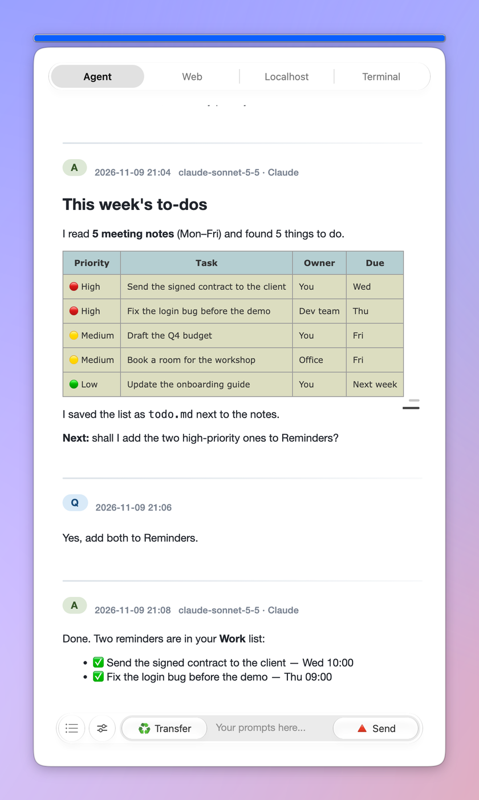
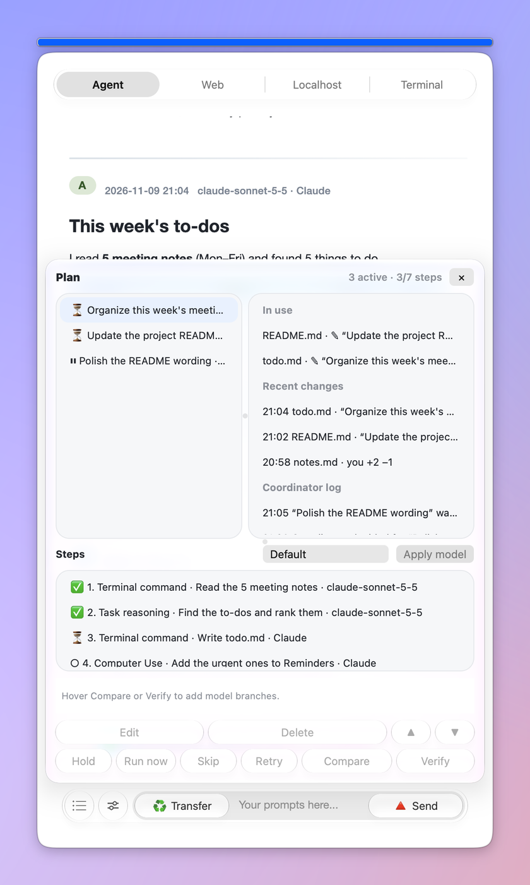
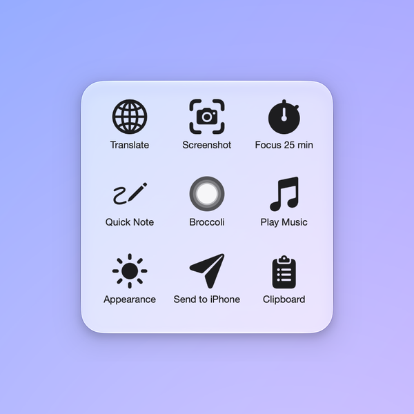
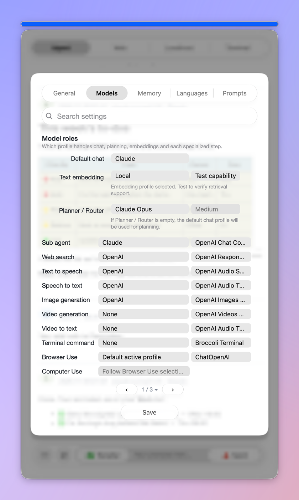

# 🥦Broccoli: A Floating Helper on Mac Desktop

<p align="center"><a href="README.md">简体中文</a> · <b>English</b> · <a href="README_JA.md">日本語</a></p>

<p align="center">
  
  
</p>

**Broccoli is an AI workstation that floats on your Mac desktop.** One small window holds your API models, the web versions of ChatGPT, Claude and Gemini, Claude Code / Codex, and a terminal. It still chats, translates, polishes and summarizes like it always did. It can now also make a plan and carry it out: run commands, drive a browser, use your computer and edit files. When several tasks run at once, a coordinator decides who goes first, so no task overwrites another's changes. Every conversation and setting stays on your own Mac.

Latest version: **v2.0.17** · Interface: English / 简体中文 / 日本語

<details>
<summary>The old introduction (v1, out of date)</summary>


~~Broccoli is a simple floating helper of GPT. Private APIs needed.~~

~~Broccoli is a desktop GPT assistant for Q&A, commands, translation, polishing and summarizing. It stores your prompts and fills them in quickly, reads long texts of any length, and exports conversations as Markdown…~~

</details>

## Why Broccoli

I built the first Broccoli in three days in February 2023. Version 2.0.8 (2026) rewrote it from scratch, and every release since has moved it towards one goal: an AI workstation on your desktop. Today it tries to solve three problems:

1. **There are more and more AIs, and they are scattered everywhere**

   ChatGPT, Claude and Gemini on the web, each provider's API, Claude Code and Codex on the command line, plus your own terminal: each lives in its own window, and you keep copying questions and answers between them. Broccoli puts them in one floating window. The **Agent** tab uses your own API models. The **Web** tab opens the web AIs directly and keeps you signed in. The **Terminal** tab runs Claude Code and Codex. Type `@` in the prompt to send the same question to any web AI and bring its answer back.

2. **AIs talk but don't act, and when they act they get in each other's way**

   Broccoli's agent first makes a plan, then works through it step by step: terminal commands, a browser, your computer, reading web pages, searching, making images and speech. You can watch every step, stop it and change it. When several tasks run at once, a coordinator keeps order. Before a task starts, it reserves the files it will change. If two tasks need the same file, one waits, and the coordinator decides who goes first. Every file write goes through Broccoli's write gate: the original is kept first, and each change can be undone on its own. Claude Code and Codex no longer write files themselves either: Broccoli reviews their changes and writes them.

3. **Your data is locked inside someone else's app**

   This is the same as on day one. Conversations, prompts, the language list and memory are plain files on your Mac (JSON, txt, Markdown): you can read, edit and export them at any time. One long-term memory can be synced to several AIs, and through iCloud your other Macs and your iPhone can continue the same conversations.

<details>
<summary>The old "Why Broccoli" (v1, out of date)</summary>

~~I built Broccoli in three days in February 2023. It began as a desktop assistant riding the trend; chat alone soon felt like too little, so I added other modes until it covered most of what "desktop assistant" apps do.~~

~~Desktop GPT apps today have these problems:~~

1. ~~**The same features, the same competitors**~~

   ~~There are a great many AI wrapper apps on the market, and people who haven't used Broccoli may take it for one. To be precise, it may once have been one, though not a browser wrapper: it was built by adapting the sample code in the official documentation. But as such apps multiply, talking to an AI is no longer the hard part; the hard part is taking the technology out of the website and fitting it to real situations and needs. So Broccoli kept adding new things. It may move a little slowly, but it starts from tools and real needs. From the start it had two unique features. First, Broccoli had a Command mode very early: from your request, an AI writes an AppleScript that you can run inside the app (system permissions required), so writing and sending an email, or searching for something in Safari, is easy. Second, long-text reading. Most document-reading services are online subscriptions that need an account and come with daily question quotas and limits on upload size and page count. Broccoli moved this to the desktop with no limits at all: all embeddings happen between your Mac and OpenAI, and questions go only to OpenAI's servers, through no third-party service (unless you use a third-party API). As long as embedding works, you can ask about a text of any length.~~

2. ~~**Similar UIs, conflicting features**~~

   ~~About a month after I wrote Broccoli, besides keeping up with daily updates, I kept seeing fresh wrappers from all sorts of developers. The most obvious sameness was in UI design. First, fonts: many apps use a web-page style. Broccoli wanted to connect with local text apps, so it chose Times New Roman, closer to a text reader, and shows conversations cleanly in Markdown, which also makes them easy to export and continue elsewhere. Second, the floating window: many desktop AI assistants use a Spotlight-like design that you summon for a quick chat. But with so many similar apps, there are only so many shortcuts to summon them, so this form may not really help people use the features and may just add redundant ones. If another app already does this, rather than reinvent the wheel, I'd like Broccoli to work well alongside it. So Broccoli can float as a small ball in the bottom-right corner of the desktop: click to expand it, and click the blue bar at the top to minimize it again. Also, a Spotlight-like window makes the floating panel an accessory of the app's main window, a fully featured add-on, which feels disjointed. If records can't be linked and synced, a careless click can make the panel vanish, and the lost information is unsettling. Making Broccoli's main window itself the floating window avoids this.~~

3. ~~**Product walls, no way to move your data**~~

   ~~Among the many similar apps, conversation history is often hard to export, especially in apps that keep a browser style; few offered the option (at least early on; later almost all did). Another striking thing: long-text reading mostly depends on online services, yet the embedding files for those texts can't be exported. If you delete the stored history, you have to do it all again, wasting computing power and money. The reason is that these apps generally don't intend to offer open text data. A similar pain point: people often want to save prompts, but prompts used inside a particular desktop app can only be reached through that app and can't be viewed on their own. So Broccoli tries to offer a plain txt file where you can read and edit your saved prompts.~~

</details>

## Highlights

### One floating window, four tabs

- **Agent**: chat, plan and run tasks with your own models (API).
- **Web**: use claude.ai, chatgpt.com, gemini.google.com and other web AIs directly; you stay signed in. Broccoli's own prompt bar sits on top of the page, so Translate, Polish and the other modes work on web pages too.
- **Localhost**: preview the dev servers you run on your Mac.
- **Terminal**: a built-in terminal that runs Claude Code and Codex, with levels (Strict / Balanced / Auto) that decide what they must ask you about first.

### Agent: plan first, then act

- A request is split into steps. The plan panel shows how far each step has got and which model runs it. You can Hold, Run now, Skip or Retry any step, and add Compare or Verify branches so another model does it again.
- Capabilities (type `/` to pick one): `/task reasoning` `/web search` `/read web page` `/browser use` `/computer use` `/terminal command` `/image generation` `/video generation` `/text to speech` `/speech to text` `/video to text`.
- Want to add something while a task is running? Use **Add note**: browser, computer-use and terminal steps that are already running will read it.
- Every command or change is reviewed by a model before it asks you. You can turn on automatic approval; admin rights, erasing disks, changing system files and sending things out always ask you first.
- **Autonomous mode** keeps going until the goal is met, judged by the commands' real output.
- After an answer, Broccoli guesses your next question and shows it in grey in the prompt; press Return to fill it in.
- Computer Use moves its own cursor and leaves your real mouse alone unless there is no other way.

### Many tasks at once, without overwriting each other

- A coordinator sits above all conversations. Before a plan runs, the files it will change are reserved. If a file it needs is being changed by another task, it waits, and the plan panel shows ⏸ and whom it is waiting for.
- When two tasks collide, the planner model decides: wait, run alongside, hand the request over, drop a duplicate, or re-plan.
- Tasks share one pool of information: every conversation can see what the others are doing, have changed and have found, and can ask another task a question through the coordinator.
- The plan panel has two columns: plans on the left and an overview on the right, with the files in use, recent changes and the coordinator's log. Right-click a change to undo just that change.

### Web AIs and command-line AIs plug in too

- Type `@` and a site name (for example `@chatgpt-com` or `@claude-ai`) and the question goes to that web AI; the answer comes back into Broccoli. ChatGPT, Claude, Gemini, Perplexity, Grok and Copilot are supported, and any page in the Localhost tab can be a target too.
- No API key? Each role in Model roles can be handed to a web AI instead.
- Claude Code and Codex run in the Terminal tab. The files they want to change go to Broccoli first, which reviews and writes them, and then they run their tests.

### The classic modes are all still here

The sliders button in the Agent tab's bottom bar (it opens the mode and language drop-downs) and the prompt bar on web pages both offer the eight modes: Chat and ask, Command (AppleScript), Translate, Polish, Summarize, Grammatically analyze, Explain code, Customize.

- Press Send with an empty prompt and Broccoli reads what is on the clipboard.
- In Translate, Polish, Summarize, Grammatically analyze and Explain code, the answer is copied to the clipboard automatically.
- Command mode writes an AppleScript; it runs only when you click **Run command**, after you have read (and maybe edited) it.
- Customize uses the prompts you saved (Settings › Prompts › Saved prompts).
- With the PopClip extension you can translate or ask about any text you select.

### Memory

- **Permanent memory**: type `/remember` to have Broccoli remember something, `/forget` to have it forget.
- **A small Wiki**: every night, the names, people and ideas from your conversations are gathered into a small Wiki (Settings › Memory).
- **Online memory sync**: read one long-term memory in and write it out to several AIs.
- **Retrieval**: old conversations and attachments can be searched; tick **Embed** on an attachment card to use embeddings.

### Your models, your way

- A **profile** is a name + an endpoint + an API key + a model. You can have many; any service with an OpenAI-compatible API works.
- **Settings › Models › Model roles** decides who handles default chat, planning, the sub agent, embeddings and each tool (web search, speech, images, video, terminal commands, Browser Use, Computer Use).
- You can also set models for one conversation or one group: click 🧠 Models in Transfer's hover column, the history right-click menu or the group settings.

### The collapsed circle and its Shortcuts grid

<p align="center"></p>

Click the blue bar at the top and Broccoli shrinks into a glass circle. The circle is its own small window that you can drag anywhere on the screen. Rest the pointer on it and a grid like iOS AssistiveTouch opens with your favourite Mac shortcuts; click the middle cell to bring the main window back.

### And more

- **Conversation groups**: group conversations, bind a folder and watch files. When a watched file changes, the change is split into tasks, each one a conversation in the group.
- **Open Connector**: connect other apps in Settings › Connected apps. Keys stay in the keychain, and you approve each action.
- **Usage bars**: coloured bars above the blue bar show how much of each AI plan you have used (CodexBar built in).
- **AI task dots**: small dots beside the pointer show the Claude Code / Codex sessions running on this Mac; hover to open them as a column of capsules.
- **Questions from iPhone**: send a question to your Mac with the "Broccoli" shortcut or the questions folder; the answer is written into Notes.
- **One Mac, several people**: everyone gets their own settings and conversations; switch users in Settings, or share this Mac with someone through an iCloud folder.
- **Question branch tree**: any question can branch off, and the whole tree is drawn as a graph.
- **Editor and reader**: AI changes are checked against the original and stop on a conflict; saving keeps the file's own encoding and line endings.
- **Also**: background vision, skills, userscripts, MCP, running code locally, finish alerts (sound and Reminders), system notifications, keeping selected text in Broccoli or Notes, one-click updates.

### Local storage

All of Broccoli's data is in this folder:

```
~/Library/Application Support/com.ryanthehito.broccoli/BroccoliAppPath
```

Each person's things are in `Users/<user>/` inside it (yours is `Users/owner/`):

- `Conversations/`: one JSON file per conversation, with its attachments in a folder next to it.
- `CustomPrompt.txt`: your saved prompts. Sets are separated by `---`; the name and the content each go inside a pair of `<|` `|>`.
- `lang.txt`: the languages for Translate, Polish, Summarize and the other modes, one per line (edit them in Settings › Languages; the first one is your main language).
- `Wiki/`, `Retrieval/`, `Editor/`…: the small Wiki, the search index, the editor's history and so on.

To save a conversation, rest the pointer on **Transfer**: **🔻 Save** writes a Markdown file, and **🔺 Share** offers Full Markdown, Task Capsule or Screenshot.

When you upgrade from an old version, whatever is in `~/BroccoliAppPath` and `~/Library/Application Support/Broccoli` is moved here the first time Broccoli opens, with a backup kept first.

<details>
<summary>The old feature notes (v1, out of date)</summary>

### ~~Local storage~~

~~All of Broccoli's portable files are stored in the folder `/Users/[user name]/BroccoliAppPath`.~~

~~The `Local` folder holds every long text after cleaning, all as txt files; in long-text mode you can open them at any time to read alongside.~~

~~The `Index` and `Embed` folders hold the documents waiting for embedding and the embedded documents, matching those in `Local`, all as csv files. For long-document reading to work, do not delete or rename them, but you can look at them at any time, and back them up or move them if you have other uses (for example reading them with code for research, to avoid doing the work twice).~~

~~`CustomPrompt.txt` is your own prompt library. Prompts are separated by `—`; each consists of a name and a content, each inside a pair of `<|``|>`. To extract them, copy them by hand, or use the rule above to clean them up with a regular expression.~~

~~Finally, `lang.txt` lists the languages you want for translating, polishing, summarizing and so on. The defaults are Chinese, English and Japanese; add or remove languages as you need. Better not to add too many: a long list is hard to search.~~

### ~~Choosing a model~~

~~Broccoli offers seven models; choose one in the first drop-down in Settings (some are outdated and no longer supported):~~

1. ~~ChatGPT (openai module, API needed)~~
2. ~~ChatGPT (httpx module, API needed; supports custom third-party services and third-party proxy APIs)~~

<details>
<summary>Modules that no longer work</summary>

1. ~~GPT-3 (openai module, API needed)~~
3. ~~ChatGPT (revChatGPT.V3 module, API needed. Note: this library is no longer maintained.)~~
4. ~~ChatGPT (revChatGPT.V1 module, session tokens needed. Note: this library is no longer maintained.)~~
6. ~~Poe (POE module, needs Quora's Formkey and Poe's cookies) (includes several sub-models such as GPT-4, ChatGPT, Claude and Claude+; convenient with a Poe subscription and syncs across platforms)~~
7. ~~EdgeGPT (EdgeGPT module, needs an imported cookies.json)~~

</details>

### ~~Saving prompts~~

~~In Settings you can save your favourite prompts in Broccoli. With the mode set to Customize, you see the prompts you saved and can switch between them easily. As described above, prompts are saved locally by a fixed rule; you can also add them in the app following that rule, and Broccoli saves every change locally. You can open, read and edit them outside the app at any time.~~

### ~~AI + AppleScript: commands written and run by AI in one click~~

~~With the mode set to Command, a new split pane appears in the main window. After you describe what you need, the AI suggests an AppleScript in that pane; you can edit it there and click Run. So you can operate the system with natural-language commands. This needs Accessibility permission in System Preferences, and if you need local files, turn on Full Disk Access beforehand. It currently works best with apps that come with macOS.~~

### ~~Talking with long texts on the desktop~~

~~Once you turn this on in the menu bar's drop-down, a split pane appears as above, and the main window's Chat and ask mode offers three embedding options: read from a new txt file, from what you type, or from old content. If your text is already in a txt file, choose the first; after that you never need to process that file again, just find it in the folder of old documents and import it. If you have no txt file, paste the text into the split pane and click the matching button to start embedding; afterwards you can reach the processed file by opening old documents. When it finishes, "Done" appears in the main window, and you can type your prompt and start the conversation.~~

### ~~Adding and removing models freely~~

~~Just like saved prompts, Broccoli now lets you define the names of every model you have used or may use.~~

### ~~One answer inserted anywhere, in any app~~

~~In the latest version, Broccoli can open a floating window anywhere in any app; after you send a prompt, select the place to insert the text with the cursor and you get one round of answer there.~~

### ~~Floating window design~~

~~Unlike Spotlight-like designs, Broccoli cares less about looking like or replacing system UI and more about continuity of use and information. After looking at other floating designs, Broccoli keeps a bar-shaped button design like Strawberry and Tomato (two apps I wrote before) when expanded, and turns the minimized window into a round icon: clear at a glance, without getting in the way of your desktop.~~

</details>

## Screenshots

1. The main window (the Agent tab): questions, answers, tables and formulas laid out cleanly, every answer marked with the model that wrote it.

<p align="center">
  
</p>

2. The plan panel: plans at the top left, the overview at the top right (files in use, recent changes, the coordinator's log), and the steps of the selected plan below.

<p align="center">
  
</p>

3. Settings (Models › Model roles): which profile does which job, on one page.

<p align="center">
  
</p>

4. The Shortcuts grid that opens from the collapsed circle.

<p align="center">
  
</p>

<details>
<summary>Old screenshots (v1, out of date)</summary>

~~New version · main window~~

<p align="center">
  
  
</p>

~~New version · settings~~

<p align="center">
  
  
</p>

~~New version · minimize animation~~


~~Old version~~

<p align="center">
  
</p>


</details>

## Requirements

- A Mac with Apple silicon (M series).
- Developed and tested on macOS 27. The Liquid Glass look needs macOS 26 or later; older systems show the plain style. Older macOS versions have not been specifically tested.
- At least one source of models: an API key for any OpenAI-compatible service, a web AI you are signed in to, or Claude Code / Codex installed.
- Optional: Browser Use needs Google Chrome; Computer Use needs CuaDriver installed separately (Broccoli's settings show the install command).
- Your own network access.

<details>
<summary>The old requirements (v1, out of date)</summary>

- ~~macOS (tested on macOS 13.6)~~
- ~~M1 or M2 chip~~
- ~~Your own network access~~

</details>

## Download and install

1. Download the latest DMG from [Releases](https://github.com/Ryan-the-hito/Broccoli/releases) (for example `Broccoli_v2.0.17.1.dmg`).
2. Open the DMG and accept the licence (GPL-3.0).
3. Drag Broccoli into the Applications folder.
4. Open Broccoli. A 🥦 icon appears in the menu bar, with "🥦 Start Broccoli!", "⚙️ Settings", "🌐 Language", "🆕 Check for Updates" and more.
5. Turn on permissions in System Settings › Privacy & Security as you need them:
   - **Accessibility**: global shortcuts, Computer Use.
   - **Screen Recording**: screenshots, background vision, Computer Use.
   - **Automation**: lets Broccoli control Notes, Reminders, System Events and others.
   - **Full Disk Access**: shows your shortcuts' icons in the collapsed circle, and reads protected files on your Mac.
6. **Updating later**: click "🆕 Check for Updates" in the menu bar. Broccoli downloads, verifies, replaces itself and reopens; your settings and conversations stay.
   - Going from v2.0.13 or earlier to v2.0.17, **install by hand once**: the app identifier is now `com.ryanthehito.broccoli`, which the old one-click updater cannot install. Afterwards, grant the permissions above again.
7. `source_open_connector.zip` and `source_agentsview.zip` in Releases: these two programs are too large for the GitHub repository, so they are attached to the release. The DMG already includes them; you only need them to run Broccoli from source. Unzip them into `open_connector/` and `agentsview/` folders next to the main script.

<details>
<summary>The old install steps (v1, out of date)</summary>

1. ~~In [Releases](https://github.com/Ryan-the-hito/Broccoli/releases), click the latest release and download the zip. Broccoli.Keyword.to.Script.alfredworkflow is a shortcut setup for Alfred that wakes and minimizes Broccoli, the same as clicking. If you have installed and bought Alfred, set it up in the workflow with the global shortcut you want.~~
2. ~~Unzip it after downloading.~~
3. ~~Drag the unzipped app into the Applications folder in Finder.~~
4. ~~Start Broccoli.~~
5. ~~A prompt asks for Accessibility permission, as below. Allow it in System Preferences. If Broccoli isn't in the list, add it by hand and tick it.~~

<p align="center">
  
</p>

6. ~~A prompt asks to control System Events, as below. Allow it.~~

<p align="center">
  
</p>

7. ~~The first time you open Broccoli, the window below appears on the desktop, and Broccoli's icon appears in the menu bar (on Macs with a notch, check that the notch isn't hiding it).~~

<p align="center">
  
  
</p>

8. ~~About updates: download the newest version from GitHub or Baidu Netdisk and drag it into Applications the same way, replacing the old one. Then open System Preferences, select Broccoli under Accessibility, click minus, then plus, and add it again. Back in the app, set up your api key, session tokens and so on again. Languages and prompts you added are kept for good, but api settings are reset when the app is replaced.~~

</details>

## How to use

1. **The window**: click the blue bar at the top and the window shrinks into the circle. Below it are the four tabs: Agent, Web, Localhost, Terminal. The bottom bar, from left to right: ☷ (opens the plan panel), the sliders button (mode and language), **Transfer**, the prompt, **Send**. The shortcut for Send is ⌘↩.
   - Rest the pointer on **Transfer**: 🔻 Save, 🔺 Share, 📸 Shot, 🧠 Models and more.
   - Rest the pointer on **Send**: 🔸 New, ➕ Add note, 🧾 Queue, 🔹 Again.

2. **Setting up models**:
   1. Open Settings › General › Add & manage profiles and make a profile: name, endpoint, API key and model.
   2. For the endpoint, enter only the address, such as `https://api.openai.com`, without `/v1/chat/completions`; a checkbox decides whether `/v1` is added.
   3. In Settings › Models › Model roles, give default chat, Planner / Router, Sub agent and the other roles to the right profiles.
   4. No API key? Give the roles to a web AI you are signed in to, or use Claude Code / Codex in the Terminal tab.

3. **Letting the agent work**: just say what you want done. To pick a specific capability, type `/` and choose from the list; to ask a web AI, type `@`. Click ☷ at the far left of the bottom bar to open the plan panel and follow each step.

4. **Classic modes**: click the sliders button in the bottom bar and pick Translate, Polish, Summarize and so on. Copy some text, leave the prompt empty and press Send: Broccoli reads the clipboard. In those five modes, the answer is copied back to the clipboard.

5. **Global shortcuts** (change them in Settings › General › Shortcuts & tools):
   - ⌃⌥B: show / hide the main window
   - ⌃⌥N: show / hide the edge-docked window
   - ⌃⌥A: the AI tasks column
   - Screenshot, same-position screenshot and the collapsed circle have no shortcut by default; set them if you like

6. **Custom prompts**: write them in Settings › Prompts › Saved prompts in the format below, then pick Customize in the mode drop-down.

```
<|Name 1|><|Content 1…|>
---
<|Name 2|><|Content 2…|>
```

7. **Questions from iPhone**: first turn on iCloud (Settings › General › History & iCloud). On the iPhone, use the "Broccoli" shortcut, or save a question into Broccoli's questions folder in iCloud. This Mac answers it, and the answer is written into Notes. In Settings you decide separately whether your other Macs, your iPhone and other people may send tasks to this Mac.

<details>
<summary>The old usage notes (v1, out of date)</summary>

1. ~~**The interface**: the pictures below show the two basic layouts and the main buttons. This is what you see the first time you open the app. Send has the shortcut cmd+return.~~

<p align="center">
  
  
</p>

2. ~~**Setting up keys**: in Settings, **first** choose the model you need.~~

<details>
<summary>Deprecated modules</summary>

- ~~GPT-3 (openai module, API needed)~~

- ~~ChatGPT (revChatGPT.V3 module, API needed. Note: this library is no longer maintained.) Same as above.~~

- ~~Poe (POE module, needs Quora's Formkey and Poe's cookies) (includes several sub-models such as GPT-4, ChatGPT, Claude and Claude+; convenient with a Poe subscription and syncs across platforms)~~
	- ~~Formkey: sign in to Quora.com (you need an account), right-click and view the Page Source (any normal browser), search for "Formkey" and put the key you find in the matching box.~~
	- ~~Cookies: sign in to Quora.com, right-click and choose Inspect, pick Cookie Editor at the top, find the cookie named "m-b", copy its value, and in the matching box first type "m-b=", then paste the value after it.~~

<p align="center">
  
</p>
<p align="center">
  
</p>
<p align="center">
  
</p>

- ~~ChatGPT (revChatGPT.V1 module, session tokens needed. Note: this library is no longer maintained.) Sign in to ChatGPT in your browser, click the button in the app to open it in that browser, find the session tokens, copy the long string into the box on the left and save.~~

<p align="center">
  
</p>

<p align="center">
  
</p>

- ~~EdgeGPT (EdgeGPT module, needs an imported cookies.json)~~
  - ~~Sign in to your Bing account in Edge, then download the [extension](https://chrome.google.com/webstore/detail/cookie-editor/hlkenndednhfkekhgcdicdfddnkalmdm).~~
  - ~~Open bing.com.~~
  - ~~Click the extension, choose "Export" and "Export as JSON".~~
  - ~~In Settings, click Add cookies.json and choose the file you saved.~~

<p align="center">
  
</p>

</details>

- ~~ChatGPT (openai module, API needed.)~~

<p align="center">
  
</p>

- ~~ChatGPT (httpx module, API needed — as above, not marked again in the picture below; supports custom third-party services and third-party proxy APIs, set up as below.) Note: when filling in the endpoint, don't include parts like "/v1/chat/completions"; enter only the address, such as "https://api.openai.com" or "https://oa.apiXXX.net". I use third-party keys from [API2D](https://api2d.com).~~

<p align="center">
  
</p>

~~**🚨If you want to customize your HOST/ENDPOINT, then you should choose the httpx module (the second one). And both two modules are by default using the official API, so it will check if the input box in Settings is blank or not. If you don’t have an official API from OpenAI, just input anything you want into that box and check “Third-party” below. Like this:**~~

<p align="center">
  
</p>

3. ~~**Talking with a file**: after you choose "Chat with a file" in the menu bar's drop-down, the main window looks like the pictures below. In Settings you can tick or untick "Show references when chatting with a file"; when ticked, after answering from a long text Broccoli also shows the passages the AI relied on. The three buttons are the three ways to read a text: import a new document, type into the text box, or open an old processed document. Importing a new document reads txt and Word files; just pick the format in the file picker.~~

<p align="center">
  
  
</p>

4. ~~**Translate, Polish, Summarize and more**: choose a built-in mode in the main window, or choose and save your own prompts.~~

   ~~Inside Broccoli, command+enter (Return) is the shortcut for "send".~~

   ~~Also, to bring in a long passage from elsewhere, for translating or polishing for example, copy it and, instead of pasting it into the box and pressing "send", just choose the mode and click "send": when the box is empty, Broccoli reads the clipboard and uses its content as the prompt.~~

   ~~Finally, in Translate, Polish, Summarize, Grammatically analyze and Explain code, Broccoli copies the answer to the clipboard, so you don't have to go back into the app to copy it.~~

- ~~Chat and ask: chat, talk, and ask about long texts.~~
- ~~Command (AppleScript): generate an AppleScript and run it in one click.~~
- ~~Translate: translate between any languages. Three are preset; add language names in Settings, preferably in their own language, one per line, save and refresh the main window to choose the new ones.~~
- ~~Polish: polish a text into the language you choose.~~
- ~~Summarize: enter a passage within the character limit (1024 tokens by default) and the AI shortens it, drawing out the gist and logic, in a target language you can choose.~~
- ~~Grammatically analyze: explain a sentence or passage in a target language, from the point of view of a grammar teacher.~~
- ~~Explain code: explain the code you enter in a target language of your choice, and point out possible errors.~~
- ~~Customize: all the prompts you saved in Settings. Prompts follow a fixed format: separated by `---`, each with a name and a content, each inside a pair of `<|` and `|>`. Here is an example.~~

```
<|Name 1|><|Content 1…|>
---
<|Name 2|><|Content 2…|>
```

5. ~~**Importing a conversation history**: in the menu bar's drop-down you can also choose "Open a chat history" to import an exported history and continue that conversation. (Note: with models that don't use an api, the platform's own history may stop it from remembering the history accurately.)~~

</details>

## Notes

1. Upgrading from v2.0.13 or earlier: install by hand once, then grant the permissions again in System Settings › Privacy & Security.
2. Settings, conversations and API keys are kept in Broccoli's data folder, so replacing the app doesn't lose them. Open Connector's keys are kept in the keychain.
3. Anything that changes your computer (terminal commands, file edits, Computer Use) asks you first by default. With automatic approval on, admin rights, erasing disks, changing system files and sending things out still always ask first.

<details>
<summary>The old notes (v1, out of date)</summary>

1. ~~After updating, grant the app its permissions again.~~
2. ~~After updating, set up the api and other keys in the app again.~~

</details>

## Licence

GPL-3.0 license

## Thanks

1. [Qt](https://github.com/qt) / PyQt6
2. [browser-use](https://github.com/browser-use/browser-use)
3. [Open Connector](https://github.com/oomol-lab/open-connector)
4. [CodexBar](https://github.com/steipete/CodexBar)
5. [agentsview](https://github.com/kenn-io/agentsview)
6. [xterm.js](https://github.com/xtermjs/xterm.js)
7. [MathJax](https://github.com/mathjax/MathJax)
8. [Mermaid](https://github.com/mermaid-js/mermaid)

<details>
<summary>Projects used by early versions</summary>

1. ~~[acheong08/ChatGPT](https://github.com/acheong08/ChatGPT)~~
2. ~~[acheong08/EdgeGPT](https://github.com/acheong08/EdgeGPT)~~
3. ~~[vaibhavk97/Poe](https://github.com/vaibhavk97/Poe)~~
4. ~~[openai-translator/openai-translator](https://github.com/yetone/openai-translator)~~

</details>

## Support the author

<p align="center">
  
  
</p>
