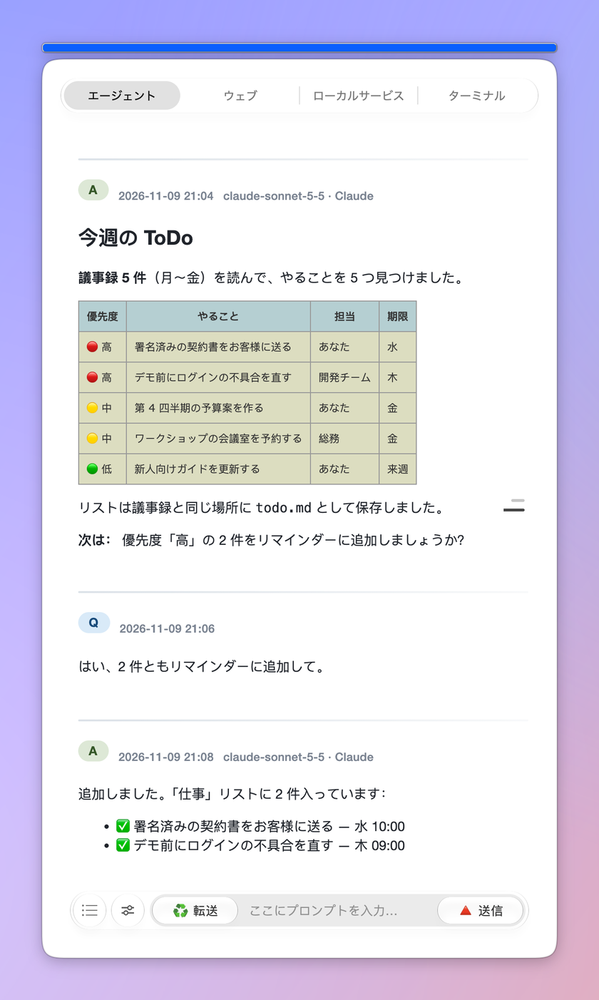
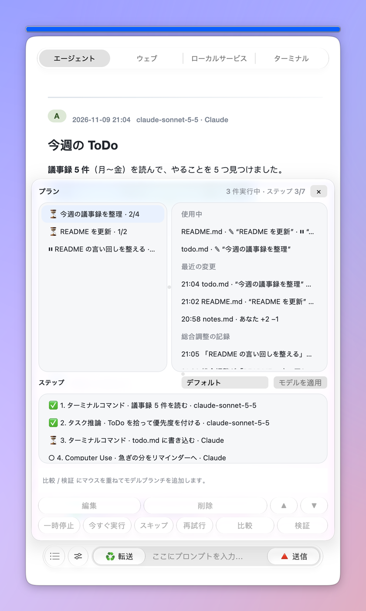
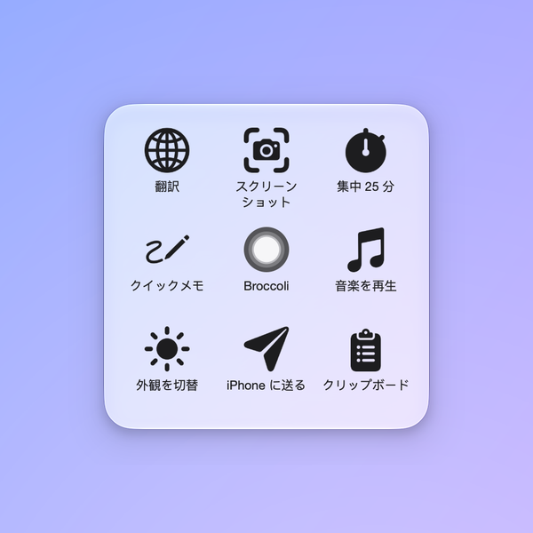
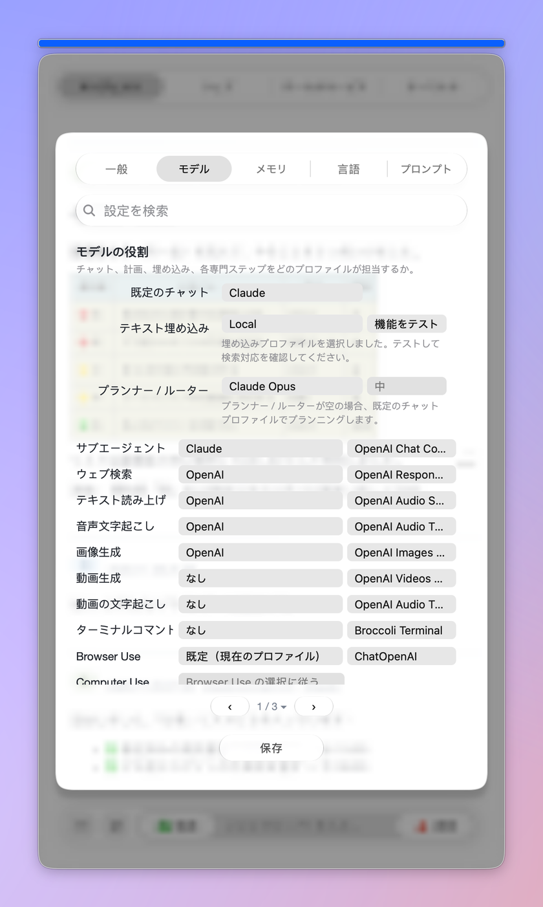

# 🥦Broccoli: A Floating Helper on Mac Desktop

<p align="center"><a href="README.md">简体中文</a> · <a href="README_EN.md">English</a> · <b>日本語</b></p>

<p align="center">
  
  
</p>

**Broccoli は、Mac のデスクトップに浮かぶ AI ワークステーションです。** 小さなウインドウ一つに、API のモデル、Web 版の AI（ChatGPT、Claude、Gemini など）、Claude Code / Codex、ターミナルがまとまっています。これまでどおりチャット・翻訳・推敲・要約ができるうえ、今では自分で計画を立てて実行することもできます。コマンドを実行し、ブラウザやコンピュータを操作し、ファイルを書き換えます。複数のタスクを同時に動かしても、総合調整（コーディネーター）が順番を決めるので、互いの変更を上書きしません。会話も設定も、すべてあなたの Mac に保存されます。

最新バージョン：**v2.0.17** · 表示言語：English / 简体中文 / 日本語

<details>
<summary>旧版の紹介（v1、古い情報）</summary>


~~Broccoli is a simple floating helper of GPT. Private APIs needed.~~

~~Broccoli はデスクトップで使う GPT アシスタントです。質問、コマンド、翻訳、推敲、要約などの機能があり、プロンプトを保存してすばやく入力でき、長さに制限なく長文を読み、会話を Markdown で書き出せます……~~

</details>

## Broccoli が解決すること

Broccoli は、2023 年 2 月に 3 日間で作った小さなアプリです。2026 年の v2.0.8 でゼロから作り直し、それ以降のバージョンはずっと「デスクトップの AI ワークステーション」を目指してきました。今、解決しようとしているのは次の三つです。

1. **AI は増える一方なのに、あちこちに散らばっている**

   Web 版の ChatGPT・Claude・Gemini、各社の API、コマンドラインの Claude Code・Codex、そして手元のターミナル。それぞれ別のウインドウで、質問や回答を何度もコピーすることになります。Broccoli はこれらを一つのフローティングウインドウにまとめます。「エージェント」タブではあなたの API モデルを使い、「ウェブ」タブでは Web 版の AI をログインしたまま直接開き、「ターミナル」タブでは Claude Code と Codex を動かします。入力欄に `@` と書けば、同じ質問を好きな Web AI に送り、その回答を取り込んで続けられます。

2. **AI は話すだけで動かない。動かすと今度はぶつかり合う**

   Broccoli のエージェントは、まず計画を立て、それから一歩ずつ実行します。ターミナルのコマンド、ブラウザ操作、コンピュータ操作、Web ページの読み取り、検索、画像や音声の生成。どのステップも見えて、止められて、変えられます。複数のタスクを同時に動かすときは、総合調整がまとめて段取りします。各タスクは始める前に変更するファイルを予約し、同じファイルを変更したいタスク同士は順番を待ちます。どちらが先かは総合調整が決めます。ファイルへの書き込みはすべて Broccoli の書き込み窓口を通り、元の内容を残してから書き込むので、変更は一つずつ取り消せます。Claude Code と Codex も自分ではファイルを書かず、提案された変更を Broccoli が確認してから書き込みます。

3. **データがほかのアプリに閉じ込められている**

   ここは最初から変わりません。会話、プロンプト、言語リスト、記憶は、どれも Mac 上の普通のファイル（JSON、txt、Markdown）で、いつでも見て、書き換えて、書き出せます。一つの長期記憶を複数の AI に同期でき、iCloud を通じてほかの Mac や iPhone からも同じ会話を続けられます。

<details>
<summary>旧版の「Broccoli が解決すること」（v1、古い情報）</summary>

~~Broccoli は、2023 年 2 月に 3 日間で作った小さなアプリです。もともとは流行に乗って作ったデスクトップアシスタントでしたが、チャットだけでは物足りなくなり、ほかのモードを加えていった結果、「デスクトップアシスタント」系アプリの機能をほぼ一通りカバーするようになりました。~~

~~いまのデスクトップ向け GPT アプリには、次のような問題があります。~~

1. ~~**機能が似通い、競合だらけ**~~

   ~~いま市場には AI のラッパーアプリが非常に多く、Broccoli を使ったことのない人はこれもその一つだと思うかもしれません。正確に言えば、以前はそうだったのかもしれません。ただしブラウザのラッパーではなく、公式ドキュメントのサンプルコードを手直しして作ったアプリです。しかしこうしたアプリが増えるにつれ、AI と話すこと自体は障壁ではなくなり、技術を Web サイトの外に連れ出し、さまざまな場面やニーズに合わせることこそが難題になりました。そこで Broccoli は新しい要素を次々に加えてきました。歩みは少し遅いかもしれませんが、道具と実際の使い道から出発したアプリです。Broccoli には設計当初から独自の機能が二つありました。一つ目は、早くからあった Command モードです。要望に応じて AI が AppleScript を書き、それをアプリ内でそのまま実行できます（システムの権限が必要）。メールを書いて送ることも、Safari で特定の内容を検索することも簡単です。二つ目は長文の読み取りです。文書を読むサービスの多くはオンラインのサブスクリプションで、アカウント登録が必要なうえ、一日の質問数、一度にアップロードできるサイズやページ数に制限があります。Broccoli はこの機能をデスクトップに移し、しかも制限は一切ありません。Embeddings の処理はすべて手元と OpenAI の間で行われ、質問も OpenAI のサーバーにだけ送られ、第三者のサービスは経由しません（第三者の API を使う場合を除く）。Embeddings がうまくいけば、どれほど長い文章でも質問できます。~~

2. ~~**UI が似ていて、機能がぶつかる**~~

   ~~Broccoli を書いて一か月ほどのあいだ、毎日の更新のほかに目に入ったのは、いろいろな開発者が作る新しいラッパーでした。とくに目立った共通点は UI デザインです。一つ目はフォントで、多くのアプリが Web ページ風のスタイルを使っています。Broccoli は手元のテキストアプリとつながることを考え、テキストリーダーに近い Times New Roman を選び、Markdown で会話をすっきり表示しています。書き出してほかのアプリで続けるのにも便利です。二つ目はフローティングウインドウです。デスクトップ版 AI アシスタントの多くは Spotlight 風のデザインで、呼び出してすぐ会話できます。しかし似たアプリが多いため、呼び出し用のショートカットには限りがあり、この形が本当に機能を使いこなす助けになるとは限らず、かえって余計な機能が増えることもあります。ほかのアプリにすでにそうした機能があるなら、車輪の再発明はせず、Broccoli は既存のアプリと組み合わせてより良い効果を出したいと考えました。そこで Broccoli は小さな球としてデスクトップの右下に浮かび、使うときはクリックで展開し、また最小化するときは上の青いバーをクリックするだけです。また、Spotlight 風のウインドウは、フローティングパネルをメインウインドウの付属品、つまり完全な機能を持つ補助機能にしてしまうため、分断された感じがあります。記録がつながらず同期もされないと、うっかりクリックしただけでパネルが消え、情報が失われる不安もあります。Broccoli はメインウインドウそのものをフローティングにすることで、この問題を避けています。~~

3. ~~**製品の壁があり、移行できない**~~

   ~~数多くの同種アプリでは、会話の履歴を書き出しにくいことがよくあります。とくにブラウザのスタイルを残したアプリでは、この選択肢を用意しているものは多くありませんでした（初期の話で、のちにはほぼすべてに備わりました）。もう一つ目立つのは、長文を読む機能の多くがオンラインに依存しているのに、その長文の Embeddings のファイルは書き出せないことです。保存した履歴を消すと、またやり直すことになり、計算資源もお金も無駄になります。こうした問題の原因は、アプリがたいてい開かれたテキスト情報を提供するつもりがないことにあります。同じような困りごととして、プロンプトを保存したいことがよくあるのに、特定のデスクトップアプリで使うプロンプトはそのアプリからしか見られず、単独では確認できません。そこで Broccoli は、保存したプロンプトを見たり書き換えたりできる、ごく普通の txt ファイルを用意しようとしています。~~

</details>

## 主な機能

### 一つのウインドウに、四つのタブ

- **エージェント**：あなたのモデル（API）でチャットし、計画を立て、タスクを実行します。
- **ウェブ**：claude.ai、chatgpt.com、gemini.google.com などの Web 版 AI をそのまま使え、ログイン状態も保たれます。ページの上には Broccoli 独自のプロンプトバーがあり、翻訳や推敲などのモードを Web ページでも使えます。
- **ローカルサービス**：Mac で動かしている開発サーバー（localhost）をプレビューします。
- **ターミナル**：内蔵ターミナルで Claude Code と Codex を直接動かせます。「厳格 / バランス / 自動」の段階で、どの操作を先に確認するかを決めます。

### エージェント：まず計画し、それから動く

- 一つの依頼はいくつかのステップに分けられます。計画パネルでは、各ステップの進み具合と使っているモデルがわかります。どのステップも一時停止・今すぐ実行・スキップ・再試行ができ、「比較」「検証」のブランチを足して別のモデルにもう一度やらせることもできます。
- 使える機能（`/` を入力して選びます）：`/task reasoning` `/web search` `/read web page` `/browser use` `/computer use` `/terminal command` `/image generation` `/video generation` `/text to speech` `/speech to text` `/video to text`。
- 実行の途中でひと言足したいときは「メモを追加」に書きます。実行中のブラウザ・コンピュータ操作・ターミナルのステップがそれを読みます。
- コマンドや変更は、あなたに確認する前にまずモデルがレビューします。自動承認も使えますが、管理者権限、ディスクの消去、システムファイルの変更、外部への送信は必ず先にあなたに確認します。
- 「全自動モード」は目標を達成するまで進み続けます。達成したかどうかは、コマンドの実際の出力で判断します。
- 回答のあと、Broccoli は次の質問を予測して入力欄に灰色で表示します。Return で入力されます。
- コンピュータ操作は専用のカーソルを使い、どうしても必要な場合を除いて、あなたの実際のマウスは動かしません。

### 複数のタスクを同時に、互いに上書きせずに

- すべての会話の上に総合調整があります。計画の実行前に、変更するファイルを予約します。必要なファイルをほかのタスクが変更中なら順番を待ち、計画パネルに ⏸ と待っている相手が表示されます。
- タスク同士がぶつかったときは計画モデルが判断します：待つ、並行して進める、依頼を相手に引き継ぐ、重複なら取り消す、または計画し直す。
- タスクは一つの情報プールを共有します。どの会話も、ほかのタスクが何をしているか、何を変更したか、何を見つけたかを確認でき、総合調整を通じてほかのタスクに質問もできます。
- 計画パネルは左右二列です。左が計画、右が概要で、使用中のファイル、最近の変更、総合調整の記録が並びます。変更を右クリックすると、その変更だけを取り消せます。

### Web の AI もコマンドラインの AI もつながる

- 入力欄に `@` とサイト名（たとえば `@chatgpt-com`、`@claude-ai`）を書くと、質問がその Web AI に送られ、回答が Broccoli に戻ってきます。ChatGPT、Claude、Gemini、Perplexity、Grok、Copilot に対応し、「ローカルサービス」タブのどのページも宛先にできます。
- API キーがなくても使えます。「モデルの役割」の各役割を Web AI に任せられます。
- Claude Code と Codex は「ターミナル」タブで動きます。変更したいファイルはまず Broccoli に渡され、Broccoli が確認して書き込んでから、テストを実行してもらいます。

### おなじみのモードもすべて健在

「エージェント」タブの下部バーにあるスライダーの丸ボタン（開くとモードと言語のドロップダウン）と、Web ページ上のプロンプトバーには、次の八つのモードがあります：チャットで質問、コマンド（AppleScript）、翻訳、推敲、要約、文法解析、コード説明、カスタマイズ。

- 入力欄が空のまま送信すると、Broccoli はクリップボードの内容を読み込みます。
- 翻訳・推敲・要約・文法解析・コード説明の五つでは、回答が自動でクリップボードにコピーされます。
- コマンドモードは AppleScript を書き出します。あなたが確認し、必要なら書き換えてから「コマンドを実行」を押したときだけ実行されます。
- カスタマイズは、保存したプロンプト（「設定 › プロンプト › 保存済みプロンプト」）を使います。
- PopClip 拡張を使えば、選択した文字をどこでも翻訳したり質問したりできます。

### 記憶

- **永続メモリ**：`/remember` と入力すると Broccoli が覚え、`/forget` で忘れます。
- **小さな Wiki**：毎晩、会話に出てきた名前・人物・概念を小さな Wiki にまとめます（「設定 › メモリ」）。
- **オンラインメモリ同期**：一つの長期記憶を読み込み、複数の AI へ書き出して同期します。
- **検索**：過去の会話や添付ファイルも検索できます。添付カードの「埋め込み」にチェックを入れると、ベクトル検索を使います。

### モデルは自由に組み合わせ

- **プロファイル** = 名前 + エンドポイント + API キー + モデル。いくつでも作れ、OpenAI 互換の API を持つサービスならどれでも使えます。
- 「設定 › モデル › モデルの役割」で、既定のチャット、計画、サブエージェント、埋め込み、各ツール（Web 検索、音声、画像、動画、ターミナルコマンド、Browser Use、Computer Use）をどのプロファイルが担当するかを決めます。
- 会話やグループごとにモデルを決めることもできます。「転送」のホバー列、履歴の右クリックメニュー、グループ設定の 🧠 モデル から設定します。

### 最小化した丸ボタンとショートカットのグリッド

<p align="center"></p>

上の青いバーをクリックすると、Broccoli はガラスの丸ボタンに縮みます。丸ボタンは独立した小さなウインドウで、画面のどこへでもドラッグできます。ポインタを乗せると、iOS の AssistiveTouch のようなグリッドが開き、よく使う Mac のショートカットを並べておけます。真ん中のマスをクリックすると、メインウインドウが戻ってきます。

### ほかにも

- **会話のグループ**：会話をグループにまとめ、フォルダーを結び付け、ファイルを監視します。監視中のファイルが変わると、変更がタスクに分けられ、それぞれがグループ内の会話になります。
- **Open Connector**：「設定 › 連携アプリ」でほかのアプリとつなぎます。キーはキーチェーンに保存され、操作ごとに承認します。
- **使用量バー**：青いバーの上の色付きバーで、各 AI プランの使用量がわかります（CodexBar 内蔵）。
- **AI タスクのドット**：ポインタの横の小さなドットが、この Mac で動いている Claude Code / Codex のセッションを示します。ホバーするとカプセルの列で表示されます。
- **iPhone から質問**：「Broccoli」ショートカットや質問フォルダーから Mac に質問を送ると、回答が「メモ」に書き込まれます。
- **1 台の Mac を複数人で**：人ごとに自分の設定と会話を持ち、設定でユーザーを切り替えます。iCloud フォルダーでこの Mac をほかの人と共有することもできます。
- **質問の分岐ツリー**：どの質問からでも分岐でき、ツリー全体がグラフで表示されます。
- **エディタとリーダー**：AI の変更は元の内容と照らし合わせ、衝突したら止まります。保存時はファイルの文字コードと改行をそのまま保ちます。
- **さらに**：バックグラウンドビジョン、スキル、ユーザースクリプト、MCP、コードのローカル実行、完了通知（サウンドとリマインダー）、システム通知、選択した文字を Broccoli や「メモ」に保存、ワンクリックアップデート。

### ローカル保存

Broccoli のデータはすべてこのフォルダーにあります。

```
~/Library/Application Support/com.ryanthehito.broccoli/BroccoliAppPath
```

人ごとの内容はその中の `Users/<ユーザー>/` にあります（あなた自身のものは `Users/owner/`）。

- `Conversations/`：会話ごとに JSON ファイルが一つ。添付ファイルは隣のフォルダーに入ります。
- `CustomPrompt.txt`、`lang.txt`：保存したプロンプトと言語リストのテキストのコピーで、アプリの外から確認できます。変更は「設定 › プロンプト」と「設定 › 言語」で行ってください。この二つのファイルは毎回設定から書き直されます。
- `Wiki/`、`Retrieval/`、`Editor/`……：小さな Wiki、検索インデックス、エディタの履歴など。

会話を保存したいときは「転送」にポインタを乗せます。「🔻 保存」で Markdown ファイルに書き出し、「🔺 共有」では完全な Markdown、タスクカプセル、スクリーンショットを選べます。

古いバージョンからアップグレードすると、`~/BroccoliAppPath` と `~/Library/Application Support/Broccoli` の中身は、初回起動時にバックアップを残したうえでここへ自動で移されます。

<details>
<summary>旧版の機能説明（v1、古い情報）</summary>

### ~~ローカル保存~~

~~このアプリ（Broccoli）の移行できるファイルは、すべて `/Users/[ユーザー名]/BroccoliAppPath` フォルダーに保存されます。~~

~~`Local` フォルダーには、テキストを整理したあとの長文がすべて txt ファイルで保存されます。長文モードではいつでもこれらを開いて表示し、読むのに役立てられます。~~

~~`Index` と `Embed` の二つのフォルダーには、Embeddings 処理を待つ文書と処理済みの文書が、`Local` のものに対応して csv ファイルで保存されます。長文の読み取りを正しく動かすため、これらを削除したり名前を変えたりしないでください。ただし、いつでも中身を見ることはでき、ほかの用途（コードで読み込んで研究に使うなど、同じ作業を繰り返さずに済みます）があれば、自分でバックアップや移行もできます。~~

~~`CustomPrompt.txt` は、自分で保存したプロンプト集です。プロンプトとプロンプトの間は `—` で区切り、各組はプロンプトの名前と内容の二つからなり、それぞれ `<|``|>` で囲みます。取り出したいときは手でコピーするか、このルールを使って正規表現で整えて書き出せます。~~

~~最後に、`lang.txt` は翻訳・推敲・要約などで使いたい言語です。既定は中国語・英語・日本語で、必要に応じて増減できます。リストが長いと探しにくいので、言語を増やしすぎないことをおすすめします。~~

### ~~複数のモデルから選択~~

~~Broccoli では 7 種類のモデルから選べます。設定の最初のドロップダウンで適切なモデルを選んでください（一部のモデルは古く、サポートが終了しています）。~~

1. ~~ChatGPT（openai モジュール、API が必要）~~
2. ~~ChatGPT（httpx モジュール、API が必要。第三者のサービスや第三者のプロキシ API の指定に対応）~~

<details>
<summary>使えなくなったモジュール</summary>

1. ~~GPT-3（openai モジュール、API が必要）~~
3. ~~ChatGPT（revChatGPT.V3 モジュール、API が必要。注：このライブラリは現在メンテナンスが止まっています。）~~
4. ~~ChatGPT（revChatGPT.V1 モジュール、session tokens が必要。注：このライブラリは現在メンテナンスが止まっています。）~~
6. ~~Poe（POE モジュール、Quora の Formkey と Poe の Cookies が必要）（GPT-4、ChatGPT、Claude、Claude+ など複数のサブモデルを含み、Poe を契約していれば手軽に使え、プラットフォームをまたいで同期できます）~~
7. ~~EdgeGPT（EdgeGPT モジュール、cookies.json の読み込みが必要）~~

</details>

### ~~プロンプトの保存~~

~~設定画面で、気に入ったプロンプトを Broccoli に保存できます。モードを Customize にすると、保存したプロンプトが表示され、簡単に切り替えられます。前述のとおり、プロンプトは決まったルールでローカルに保存され、そのルールに従ってアプリ内で追加することもでき、変更はすべて Broccoli がローカルに自動保存します。アプリの外からいつでも開いて、見て、書き換えられます。~~

### ~~AI + AppleScript：AI がコマンドを生成してワンクリックで実行~~

~~モードを Command にすると、メイン画面に新しい分割ペインが現れます。要望を入力すると、AI がそのペインに AppleScript の候補を出します。ペインの中で書き換えてから、実行をクリックできます。こうして自然言語でシステムを操作できます。この機能を使うには、システム環境設定でアクセシビリティの権限を与える必要があり、ローカルのファイルにアクセスするなら、あらかじめフルディスクアクセスもオンにしておくとよいでしょう。今のところ、macOS 付属のアプリでうまく動きます。~~

### ~~デスクトップで長文と対話~~

~~メニューバーのドロップダウンでこの機能をオンにすると、前の機能と同じく分割ペインが現れるほか、メイン画面の Chat and ask モードに三つの Embeddings の方法が加わります。新しい txt ファイルから読む、入力した内容から読む、以前の内容から読む、の三つです。文章がすでに txt ファイルにまとまっているなら一つ目を選びます。以後、その文書を処理し直す必要はなく、以前の文書のフォルダーから見つけて読み込むだけです。また、手元に txt ファイルがなければ、文章を分割ペインに貼り付けて対応するボタンを押せば Embeddings が始まり、あとから以前の文書を開く方法で処理済みのファイルにアクセスできます。処理が終わるとメイン画面に「Done」と表示され、プロンプト欄に入力して対話を始められます。~~

### ~~モデルを自由に増減~~

~~プロンプトの保存と同じように、使ったことのあるモデルや今後使うかもしれないモデルの名前を、すべて自分で決められるようになりました。~~

### ~~どのアプリのどこにでも、回答を 1 回挿入~~

~~最新版では、どのアプリのどこでもフローティングウインドウを開けます。プロンプトを送ったあと、テキストを挿入したい位置をカーソルで選ぶだけで、その場に 1 回分の回答が入ります。~~

### ~~フローティングウインドウのデザイン~~

~~Spotlight 風のデザインとは違い、Broccoli が重視するのは、UI がシステムに似ているか、置き換えられるかではなく、使い方と情報の連続性です。ほかのフローティングデザインを参考にしたうえで、Broccoli は展開時に Strawberry や Tomato（以前に書いた二つのアプリ）と同じようなバー形のボタンデザインを保ち、最小化したウインドウは丸いアイコンにしました。ひと目でわかり、デスクトップでの普段の作業の邪魔にもなりません。~~

</details>

## 画面

1. メイン画面（「エージェント」タブ）：質問、回答、表、数式がきれいに並び、どの回答にも書いたモデルが表示されます。

<p align="center">
  
</p>

2. 計画パネル：左上が計画、右上が概要（使用中のファイル、最近の変更、総合調整の記録）、下は選んだ計画の各ステップです。

<p align="center">
  
</p>

3. 設定画面（「モデル › モデルの役割」）：どの仕事をどのプロファイルに任せるか、1 ページで見渡せます。

<p align="center">
  
</p>

4. 最小化した丸ボタンから開くショートカットのグリッド。

<p align="center">
  
</p>

<details>
<summary>旧版のスクリーンショット（v1、古い情報）</summary>

~~新しいバージョン · メイン画面~~

<p align="center">
  
  
</p>

~~新しいバージョン · 設定画面~~

<p align="center">
  
  
</p>

~~新しいバージョン · 最小化のアニメーション~~


~~古いバージョン~~

<p align="center">
  
</p>


</details>

## 動作環境

- Apple シリコン（M シリーズ）の Mac。
- macOS 27 で開発・テストしています。Liquid Glass の見た目には macOS 26 以降が必要で、それより前のシステムでは通常のスタイルで表示されます。それより前の macOS は特にテストしていません。
- モデルの入手先が少なくとも一つ：OpenAI 互換サービスの API キー、ログイン済みの Web AI、またはインストール済みの Claude Code / Codex。
- 任意：Browser Use には Google Chrome が、Computer Use には別途 CuaDriver のインストールが必要です（Broccoli の設定にインストール用のコマンドがあります）。
- ネットワーク環境はご自身でご用意ください。

<details>
<summary>旧版の動作環境（v1、古い情報）</summary>

- ~~macOS（テスト環境は macOS 13.6）~~
- ~~M1、M2 チップ~~
- ~~ネットワーク環境はご自身でご用意ください~~

</details>

## ダウンロードとインストール

1. [Releases](https://github.com/Ryan-the-hito/Broccoli/releases) から最新の DMG（例：`Broccoli_v2.0.17.1.dmg`）をダウンロードします。
2. DMG を開き、使用許諾（GPL-3.0）に同意します。
3. Broccoli を「アプリケーション」フォルダーにドラッグします。
4. Broccoli を開きます。メニューバーに 🥦 アイコンが現れ、「🥦 Broccoli を起動！」「⚙️ 設定」「🌐 言語」「🆕 アップデートを確認」などがあります。
5. 必要に応じて「システム設定 › プライバシーとセキュリティ」で Broccoli に権限を与えます。
   - **アクセシビリティ**：グローバルショートカット、コンピュータ操作。
   - **画面収録**：スクリーンショット、バックグラウンドビジョン、コンピュータ操作。
   - **オートメーション**：Broccoli が「メモ」「リマインダー」や System Events などを操作するため。
   - **フルディスクアクセス**：最小化した丸ボタンでショートカットのアイコンを表示するため、また Mac 上の保護されたファイルを読むため。
6. **今後のアップデート**：メニューバーの「🆕 アップデートを確認」をクリックすると、Broccoli が自分でダウンロード・検証・置き換え・再起動まで行います。設定も会話も失われません。
   - v2.0.13 以前から v2.0.17 へ上げるときは、**一度だけ手動でインストール**してください。アプリ識別子が `com.ryanthehito.broccoli` に変わったため、旧版のワンクリックアップデートではインストールできません。インストール後、上の権限をもう一度与えてください。
7. Releases にある `source_open_connector.zip` と `source_agentsview.zip`：この二つのプログラムは大きすぎて GitHub のリポジトリに入らないため、リリースに添付しています。DMG には同梱済みなので、ソースコードから Broccoli を実行する場合だけ必要です。解凍して、メインのスクリプトの隣の `open_connector/` と `agentsview/` フォルダーに置いてください。

<details>
<summary>旧版のインストール手順（v1、古い情報）</summary>

1. ~~[Releases](https://github.com/Ryan-the-hito/Broccoli/releases) で最新のリリースを開き、zip をダウンロードします。なお、Broccoli.Keyword.to.Script.alfredworkflow は Alfred 用のショートカット設定で、クリックと同じように Broccoli を呼び出したり最小化したりできます。Alfred をインストール・購入済みの方は、workflow でこのファイルを設定し、好きなグローバルショートカットを割り当ててください。~~
2. ~~ダウンロードしたら解凍します。~~
3. ~~解凍した app を Finder の「アプリケーション」フォルダーにドラッグします。~~
4. ~~Broccoli を起動します。~~
5. ~~下の図のように、アクセシビリティの権限を求めるダイアログが出ます。システム環境設定で許可してください。リストに Broccoli がなければ、手動で追加してチェックを入れてください。~~

<p align="center">
  
</p>

6. ~~下の図のように、System Events の操作を求めるダイアログが出ます。許可してください。~~

<p align="center">
  
</p>

7. ~~初めて Broccoli を開くと、デスクトップに下のようなウインドウが表示され、同時にメニューバーに Broccoli のアイコンが現れます（ノッチのある機種では、ノッチに隠れて見えなくなっていないか確認してください）。~~

<p align="center">
  
  
</p>

8. ~~アップデートについて：GitHub か Baidu Netdisk から最新版をダウンロードし、同じように「アプリケーション」にドラッグして上書きしてください。そのあとシステム環境設定を開き、アクセシビリティで Broccoli を選んでマイナスを押し、次にプラスを押して、もう一度追加してください。アプリに戻ったら、api key や session tokens などを設定し直します。追加した言語とプロンプトはずっと保存されるので安心してください。api などの情報はアプリの置き換えとともにリセットされます。~~

</details>

## 使い方

1. **画面**：いちばん上の青いバーをクリックすると、ウインドウが丸ボタンに縮みます。その下に四つのタブ（エージェント、ウェブ、ローカルサービス、ターミナル）があります。下部バーは左から：☷（計画パネルを開く）、スライダーのボタン（モードと言語）、「転送」、入力欄、「送信」。送信のショートカットは ⌘↩ です。
   - 「転送」にポインタを乗せると：🔻 保存、🔺 共有、📸 スクショ、🧠 モデル など。
   - 「送信」にポインタを乗せると：🔸 新規、➕ メモを追加、🧾 キュー、🔹 もう一度。

2. **モデルの設定**：
   1. 「設定 › 一般 › プロファイルの追加と管理」でプロファイルを作り、名前、エンドポイント、API キー、モデルを入れます。
   2. エンドポイントにはアドレスだけを入れます（例：`https://api.openai.com`）。`/v1/chat/completions` は書きません。`/v1` を付け足すかどうかはチェックボックスで決めます。
   3. 「設定 › モデル › モデルの役割」で、既定のチャット、プランナー / ルーター、サブエージェントなどの役割を、それぞれ合うプロファイルに割り当てます。
   4. API キーがなくても大丈夫です。ログイン済みの Web AI に役割を任せるか、「ターミナル」タブで Claude Code / Codex を使ってください。

3. **エージェントに任せる**：やってほしいことをそのまま書きます。特定の機能を指定したいときは `/` を入力して一覧から選び、Web AI に聞きたいときは `@` を入力します。下部バーのいちばん左の ☷ で計画パネルを開くと、各ステップを追えます。

4. **おなじみのモード**：下部バーのスライダーのボタンを押し、モードのドロップダウンで翻訳・推敲・要約などを選びます。文字をコピーして、入力欄を空のまま送信すると、Broccoli がクリップボードを読み込みます。この五つのモードでは、回答がクリップボードにコピーし戻されます。

5. **グローバルショートカット**（「設定 › 一般 › ショートカットとツール」で変更）：
   - ⌃⌥B：メインウインドウの表示 / 非表示
   - ⌃⌥N：画面端にドッキングしたウインドウの表示 / 非表示
   - ⌃⌥A：AI タスクの列
   - スクリーンショット、同じ位置のスクリーンショット、最小化した丸ボタンには既定のショートカットがありません。必要なら設定してください

6. **カスタムプロンプト**：「設定 › プロンプト › 保存済みプロンプト」を開いて「新」を押し、リストで名前を付け、下の「プロンプト本文」に内容を書いて「保存」を押します。本文に `{text}` と書いた所には、入力欄に入力した文字が入ります。使うときは、モードのドロップダウンで「カスタマイズ」を選び、プロンプトを選びます。

7. **iPhone から質問**：まず iCloud をオンにします（「設定 › 一般 › 履歴と iCloud」）。iPhone で「Broccoli」ショートカットを使うか、iCloud にある Broccoli の質問フォルダーに質問を保存すると、この Mac が回答し、回答は「メモ」に書き込まれます。ほかの Mac、あなたの iPhone、ほかの人のそれぞれについて、この Mac にタスクを送れるかどうかを設定で決められます。

<details>
<summary>旧版の使い方（v1、古い情報）</summary>

1. ~~**画面の説明**：下の図は、二つの基本レイアウトと主なボタンです。アプリを開いて最初に表示されるのがこの画面です。Send ボタンのショートカットは cmd+return です。~~

<p align="center">
  
  
</p>

2. ~~**キーの設定**：設定ウインドウで、**まず**使いたいモデルを選びます。~~

<details>
<summary>Deprecated modules（サポートが終了したモデル）</summary>

- ~~GPT-3（openai モジュール、API が必要）~~

- ~~ChatGPT（revChatGPT.V3 モジュール、API が必要。注：このライブラリは現在メンテナンスが止まっています。）上と同じです。~~

- ~~Poe（POE モジュール、Quora の Formkey と Poe の Cookies が必要）（GPT-4、ChatGPT、Claude、Claude+ など複数のサブモデルを含み、Poe を契約していれば手軽に使え、プラットフォームをまたいで同期できます）~~
	- ~~Formkey について：まず Quora.com にログインし（アカウントが必要）、右クリックで Page Source を表示し（一般的なブラウザならどれでも可）、「Formkey」を検索して、見つかったキーを該当の欄に入れます。~~
	- ~~Cookies について：Quora.com にログインし、右クリックで Inspect を選び、上部で Cookie Editor を選んで「m-b」という名前の Cookie を探し、その文字列をコピーします。該当の欄にまず「m-b=」と入力し、その後ろに文字列を貼り付けます。~~

<p align="center">
  
</p>
<p align="center">
  
</p>
<p align="center">
  
</p>

- ~~ChatGPT（revChatGPT.V1 モジュール、session tokens が必要。注：このライブラリは現在メンテナンスが止まっています。）まずブラウザで ChatGPT にログインし、画面のボタンを押して、さきほどログインしたブラウザで開き、session tokens を見つけます。その長い文字列をコピーして左の欄に入れ、保存します。~~

<p align="center">
  
</p>

<p align="center">
  
</p>

- ~~EdgeGPT（EdgeGPT モジュール、cookies.json の読み込みが必要）~~
  - ~~Edge で Bing アカウントにログインし、[拡張機能](https://chrome.google.com/webstore/detail/cookie-editor/hlkenndednhfkekhgcdicdfddnkalmdm)をダウンロードします。~~
  - ~~bing.com を開きます。~~
  - ~~拡張機能をクリックし、「Export」から「Export as JSON」を選びます。~~
  - ~~設定画面で Add cookies.json を押し、さきほど保存したファイルを選びます。~~

<p align="center">
  
</p>

</details>

- ~~ChatGPT（openai モジュール、API が必要。）~~

<p align="center">
  
</p>

- ~~ChatGPT（httpx モジュール、API が必要。上と同じなので下の図では省略。第三者のサービスや第三者のプロキシ API の指定に対応し、下の図のように設定します。）注意：endpoint を入れるときは「/v1/chat/completions」のような部分は書かず、「https://api.openai.com」「https://oa.apiXXX.net」のようにアドレスだけを入れてください。私は [API2D](https://api2d.com) の第三者キーを使っています。~~

<p align="center">
  
</p>

~~**🚨If you want to customize your HOST/ENDPOINT, then you should choose the httpx module (the second one). And both two modules are by default using the official API, so it will check if the input box in Settings is blank or not. If you don’t have an official API from OpenAI, just input anything you want into that box and check “Third-party” below. Like this:**~~

<p align="center">
  
</p>

3. ~~**文書との対話モード**：メニューバーのドロップダウンで「Chat with a file」を選ぶと、メイン画面は下の図のようになります。設定画面で「Show references when chatting with a file」をオン / オフできます。オンにすると、長文を読んで回答したあと、AI が回答の根拠にした文章も表示します。画面の三つのボタンは、文章を読む三つの方法に対応しています。新しい文書から読み込む、テキスト欄に入力する、処理済みの以前の文書を開く、です。新しい文書からは txt と Word の文書を読み込めます。ファイル選択でその形式を選ぶだけです。~~

<p align="center">
  
  
</p>

4. ~~**翻訳・推敲・要約などの機能**：メイン画面のモードで、さまざまな内蔵機能を選べるほか、自分のプロンプトを選んで保存することもできます。~~

   ~~Broccoli の画面では command+enter（Return）が「send」ボタンのショートカットになります。~~

   ~~また、翻訳や推敲などで外から長い文章を持ち込みたいときは、文章をコピーしたら、入力欄に貼り付けて「send」を押す代わりに、モードを選んでそのまま「send」を押せます。入力欄が空のとき、Broccoli はクリップボードを読み込み、その内容をプロンプトとして使います。~~

   ~~最後に、翻訳・推敲・要約・文法の説明・コードの解説のモードでは、Broccoli が回答をクリップボードにコピーするので、アプリに戻って選択・コピーする必要がありません。~~

- ~~Chat and ask：チャット、会話、長文への質問。~~
- ~~Command (AppleScript)：AppleScript を生成し、ワンクリックで実行。~~
- ~~Translate：任意の言語の間で翻訳できます。三つの言語が用意されており、設定画面で言語名を追加できます。なるべくその言語自身の表記で 1 行に一つずつ書き、保存してメイン画面を更新すると、新しく追加した言語を選べます。~~
- ~~Polish：文章を推敲します。推敲後の言語を選べます。~~
- ~~Summarize：文字数制限（既定は 1024 tokens）以内の文章を入れると、AI が要点と論理を抜き出して短くまとめます。出力の言語も選べます。~~
- ~~Grammatically analyze：文や文章を、選んだ言語で説明します。AI が文法の先生の立場から分析します。~~
- ~~Explain code：入力したコードを選んだ言語で説明し、誤りがありそうかどうかも伝えます。~~
- ~~Customize：設定画面で保存したすべてのプロンプトを含むカスタムのオプションです。プロンプトは決まった形式に従い、`---` で区切り、各組は名前と内容の二つの部分からなり、それぞれ `<|` と `|>` で囲みます。以下は例です。~~

```
<|名前 1|><|内容 1……|>
---
<|名前 2|><|内容 2……|>
```

5. ~~**会話履歴の読み込み**：メニューバーのドロップダウンで「Open a chat history」を選ぶと、以前に書き出した履歴を読み込み、その会話を続けられます。（注：API に依存しないモデルを使う場合、そのプラットフォームの履歴の影響で、履歴を正確に覚えられないことがあります。）~~

</details>

## 注意事項

1. v2.0.13 以前からアップグレードする場合：一度だけ手動でインストールし、「システム設定 › プライバシーとセキュリティ」で権限をもう一度与えてください。
2. 設定、会話、API キーは Broccoli のデータフォルダーに保存されるので、アプリを置き換えても失われません。Open Connector のキーはキーチェーンに保存されます。
3. あなたのコンピュータに変更を加える操作（ターミナルのコマンド、ファイルの変更、コンピュータ操作）は、既定ではすべて先にあなたに確認します。自動承認をオンにしても、管理者権限、ディスクの消去、システムファイルの変更、外部への送信は必ず先に確認します。

<details>
<summary>旧版の注意事項（v1、古い情報）</summary>

1. ~~アップデート後は、アプリに権限を与え直してください。~~
2. ~~アップデート後は、アプリ内の api などのキーを設定し直してください。~~

</details>

## ライセンス

GPL-3.0 license

## 謝辞

1. [Qt](https://github.com/qt) / PyQt6
2. [browser-use](https://github.com/browser-use/browser-use)
3. [Open Connector](https://github.com/oomol-lab/open-connector)
4. [CodexBar](https://github.com/steipete/CodexBar)
5. [agentsview](https://github.com/kenn-io/agentsview)
6. [xterm.js](https://github.com/xtermjs/xterm.js)
7. [MathJax](https://github.com/mathjax/MathJax)
8. [Mermaid](https://github.com/mermaid-js/mermaid)

<details>
<summary>初期のバージョンで使っていたプロジェクト</summary>

1. ~~[acheong08/ChatGPT](https://github.com/acheong08/ChatGPT)~~
2. ~~[acheong08/EdgeGPT](https://github.com/acheong08/EdgeGPT)~~
3. ~~[vaibhavk97/Poe](https://github.com/vaibhavk97/Poe)~~
4. ~~[openai-translator/openai-translator](https://github.com/yetone/openai-translator)~~

</details>

## 作者を応援する

<p align="center">
  
  
</p>
